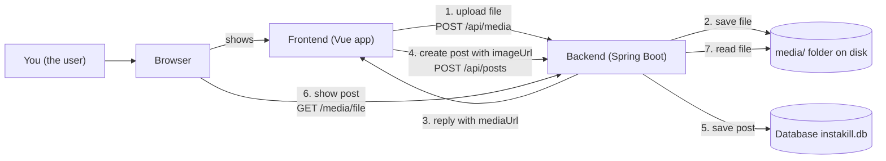
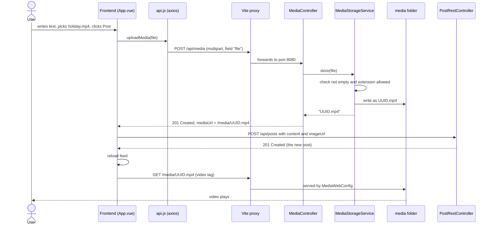

# Week 3 – Media Upload: Solution Explained

> **In one paragraph:** Before this assignment, a post in Instakill could only show a picture if you already had that picture hosted somewhere else on the internet and pasted its web address. After this assignment, you can pick an image or a video **from your own computer** while writing a post. The app sends that file to our own server, which stores it in a folder on disk (`media/`) and replies with the file's new web address (for example `/media/3f2a…c9.mp4`). The post then stores that address, and anyone viewing the feed loads the image or plays the video directly from our server.

---

## Table of contents

1. [The big picture](#1-the-big-picture)
2. [Background concepts you need](#2-background-concepts-you-need)
3. [What the assignment asks for](#3-what-the-assignment-asks-for)
4. [The solution, step by step](#4-the-solution-step-by-step)
5. [Optional extras](#5-optional-extras)
6. [Verification: bugs found and fixed, known limitations](#6-verification-bugs-found-and-fixed-known-limitations)
7. [Requirement → code checklist](#7-requirement--code-checklist)
8. [How to run and test it yourself](#8-how-to-run-and-test-it-yourself)
9. [Glossary](#9-glossary)

---

## 1. The big picture

### 1.1 The problem, with an analogy

Think of Instakill as a **community notice board** in a building.

- **Before:** you could pin a note to the board, and if you wanted a photo on it, you had to write down *where* the photo could be found: "see the photo in the library, shelf 4". The board itself never held photos.
- **After:** the building now has a **storage room** (the `media/` folder). You hand your photo or video to the **receptionist** (the upload endpoint). The receptionist puts it in the storage room under a unique label and gives you back a slip: "your file is at storage room, box `3f2a…c9.mp4`". You write that slip's address on your note. Anyone reading the note can walk to the storage room and see the photo, or watch the video.

The assignment is about building that receptionist, that storage room, and the "walk to the storage room" path, and then teaching the post-writing screen to use them.

### 1.2 The pieces involved

There are four pieces, and the whole feature is about how they pass a file and an address between each other:

| Piece | What it is | Where it lives in the repo |
|---|---|---|
| **Browser** | The program you use to view websites (Chrome, Firefox…). It shows the app and sends requests. | Your computer |
| **Frontend** | The part of Instakill that runs *inside* the browser: the screens, buttons and forms. Written with **Vue**. | [`frontend/`](../../frontend/) |
| **Backend** | The program that runs on the server, receives requests, applies rules (who is logged in, what is allowed) and stores data. Written in **Java** with **Spring Boot**. | [`backend/`](../../backend/) |
| **Disk + database** | Where things are kept permanently. Posts live in a database file (`instakill.db`); uploaded files now live in the `media/` folder. | `backend/instakill.db`, `backend/media/` |

### 1.3 Architecture diagram



Read it as a story: the file goes **up** once (steps 1–3), the post is created with the file's address (steps 4–5), and later every viewer's browser fetches the file **down** using that address (steps 6–7).

---

## 2. Background concepts you need

This section explains, from zero, every idea the solution relies on. If you already know a concept, skip its subsection.

### 2.1 Client and server

A **server** is a program that waits for questions and answers them. A **client** is a program that asks questions. Here, the browser (running the frontend) is the client, and the backend is the server.

*Analogy:* a restaurant. You (client) order at the counter; the kitchen (server) prepares the dish and hands it back. The kitchen never comes to your table unasked; it only reacts to orders.

On your own computer, both run on the same machine. The server is reached at the address **`localhost`**, which means "this computer". A **port** is a numbered door on that machine: the backend listens on door `8080`, the frontend's development server on door `5173`.

### 2.2 HTTP requests and responses

Clients and servers talk using **HTTP**, a simple text-based language. Every conversation is one **request** (the question) and one **response** (the answer).

A request has:
- a **method**, which is the kind of action: `GET` means "give me something", `POST` means "here is something new, please accept it", `DELETE` means "remove something";
- a **path**, which is what the request is about, like `/api/media` or `/media/abc.mp4`;
- **headers**, which are small labelled notes about the request, like "the body is JSON" or "here is my login cookie";
- optionally a **body**, which is the actual content being sent (e.g. the file).

A response has:
- a **status code**, a 3-digit number summarizing the outcome;
- headers;
- a body (e.g. JSON data, an image, a video).

The status codes that matter in this assignment:

| Code | Name | Meaning here |
|---|---|---|
| `200` | OK | "Here's what you asked for" (e.g. the video file). |
| `201` | Created | "I accepted your upload and created a new file." |
| `206` | Partial Content | "Here is the *part* of the file you asked for" (used for video playback, see 2.9). |
| `400` | Bad Request | "Your request is wrong" (e.g. empty file, forbidden file type). |
| `401` | Unauthorized | "I don't know who you are; log in first." |
| `403` | Forbidden | "I know the rules, and they say no." |
| `413` | Payload Too Large | "Your file is bigger than I accept." |
| `500` | Internal Server Error | "Something broke on my side." |

A tiny example of a request and its response:

```http
GET /api/health HTTP/1.1
Host: localhost:8080

HTTP/1.1 200 OK
Content-Type: application/json

{"status":"UP"}
```

### 2.3 Endpoints and REST APIs

An **endpoint** is one specific "counter window" of the server: a combination of method + path that the server knows how to answer. For example, `POST /api/posts` is the "create a post" window, and after this assignment `POST /api/media` is the "upload a file" window.

An **API** (Application Programming Interface) is the full list of windows a program offers to other programs. Instakill's backend offers a **REST API**: a style where paths name *things* (posts, comments, media) and methods name the *action* on those things. All of Instakill's REST endpoints start with `/api/`.

### 2.4 JSON

**JSON** (JavaScript Object Notation) is the most common way to write structured data as text. It uses curly braces for "an object with named fields" and square brackets for lists:

```json
{ "mediaUrl": "/media/3f2a9c1e-7b1d-4c55-9f0e-1a2b3c4d5e6f.mp4" }
```

This is exactly what our upload endpoint answers: an object with one field, `mediaUrl`, whose value is the file's address. The frontend reads this field out.

### 2.5 Uploading a file: `multipart/form-data`

JSON is text, but videos and photos are **binary data** (raw bytes, not readable characters). To send a file over HTTP, browsers use a special body format called **`multipart/form-data`**.

*Analogy:* a parcel with several compartments. Each compartment (a **part**) has a label on it, its **field name**, and holds one thing. A part can hold a file, along with the file's original name and its type.

What a multipart upload looks like on the wire, simplified:

```http
POST /api/media HTTP/1.1
Content-Type: multipart/form-data; boundary=----XYZ

------XYZ
Content-Disposition: form-data; name="file"; filename="holiday.mp4"
Content-Type: video/mp4

<...millions of raw bytes of the video...>
------XYZ--
```

- `boundary=----XYZ` is the separator line between compartments (the browser picks a random one).
- `name="file"` is the **field name**. The assignment requires it to be exactly `file`, because that's the label the server looks for.
- `filename="holiday.mp4"` is the original name on your computer.
- `Content-Type: video/mp4` is the file's **content type** (also called **MIME type**): a standard label saying what kind of data it is (`image/png`, `video/mp4`…).

### 2.6 Static file serving

Some responses are computed (e.g. "the 10 newest posts"). Others are just **files read from disk and sent as-is**: images, videos, stylesheets. Sending files unchanged like this is called **static file serving**. The server maps a URL path to a folder: "requests for `/media/<name>` → read `<name>` from the `media/` folder and send it."

### 2.7 Configuration files (YAML)

Some values shouldn't be hard-wired in code, because you may want to change them without editing Java: where to store files, or how big an upload may be. Spring Boot reads such values from a **configuration file**, here [`application.yaml`](../../backend/src/main/resources/application.yaml).

**YAML** is a text format where indentation shows nesting:

```yaml
media:
  base-path: media
```

means "the setting `media.base-path` has the value `media`". The assignment mentions `application.properties`, which is an equivalent older format (`media.base-path=media`). The assignment explicitly allows either.

There's also a separate configuration for **tests**, [`application-test.yaml`](../../backend/src/test/resources/application-test.yaml), so tests don't touch your real data.

### 2.8 Authentication and cookies

**Authentication** means proving who you are, which in Instakill means logging in. After login, the backend gives the browser a **cookie** named `ACCESS_TOKEN`.

*Analogy:* a festival wristband. You show your ticket once at the entrance (log in), get a wristband (cookie), and from then on the guards (backend) just look at your wristband. The browser automatically shows the wristband with every request to the same server.

The cookie holds a **JWT** (JSON Web Token): a signed piece of text saying "this is user X, valid until time T". The backend can check the signature to make sure nobody forged it. This existed before the assignment; we simply reuse it to make sure only logged-in users can upload.

### 2.9 Video playback and range requests

Browsers don't download a whole video before playing it. They ask for **pieces**: "give me bytes 0 to 1,000,000", then the next piece, and so on. This is called a **range request** (header `Range: bytes=0-999999`), and the server answers `206 Partial Content`. It also lets you jump to the middle of a video. Spring's static file serving supports this out of the box, which is why the assignment says *"no transcoding involved"*: we never convert the video, we just hand out the original bytes. **Transcoding** would mean converting a video to another format or quality.

### 2.10 Spring Boot in five ideas

**Spring Boot** is the Java framework the backend is built on. A **framework** is a ready-made skeleton you fill in; it calls *your* code at the right moments. Five ideas cover everything in this solution:

1. **Annotations.** Words starting with `@` placed above Java code, like `@RestController`. They are labels that tell Spring "treat this class/method specially". They don't run anything by themselves; Spring reads them at startup.
2. **Beans and dependency injection.** Spring creates one instance of each important class (a **bean**) at startup. If a class's constructor asks for another bean (e.g. the controller asks for the storage service), Spring hands it over automatically. This is called **dependency injection**. You never write `new MediaStorageService(...)` yourself.
3. **Controllers.** Classes that define endpoints. Each method is one counter window.
4. **Services.** Classes that hold the actual logic (validate, save…), kept separate from the HTTP details.
5. **Exceptions.** In Java, when something goes wrong, code **throws an exception**, an object describing the problem that interrupts normal flow. Spring can catch exceptions and turn them into proper HTTP error responses.

### 2.11 The frontend: Vue, axios and the Vite proxy

- **Vue** is a JavaScript framework for building screens. A Vue file (`.vue`) has a `<template>` (the HTML layout), a `<script>` (the behavior) and a `<style>` (the look). Vue keeps the screen in sync with variables automatically: change a variable, and the screen updates. This is called **reactivity**.
- **axios** is a small JavaScript library for sending HTTP requests from the browser.
- **Vite** is the tool that runs the frontend during development, at `http://localhost:5173`. Because the backend lives on a *different* port (`8080`), Vite acts as a **proxy**, a middleman: when the browser asks Vite for `/api/...`, Vite quietly forwards the request to `http://localhost:8080/api/...` and passes the answer back. To the browser, everything appears to come from one place.

### 2.12 UUIDs

A **UUID** (Universally Unique Identifier) is a random 128-bit number written like `3f2a9c1e-7b1d-4c55-9f0e-1a2b3c4d5e6f`. There are so many possible values that two randomly generated UUIDs practically never collide. We use one as each uploaded file's new name.

---

## 3. What the assignment asks for

The full text is in [`description.md`](description.md). Here it is in plain language, with **why** each part matters.

### 3.1 The goal

Let users attach images and videos from their own computer to posts. Uploaded files are stored on our server in a local `media/` folder, and each post remembers the file's web address.

### 3.2 The acceptance criteria (what "done" means)

1. **An upload endpoint: `POST /api/media`.** It receives a file as `multipart/form-data` in a field called `file`, and answers `201 Created` with `{ "mediaUrl": "/media/<filename>" }`.
   - *Why:* the frontend needs one fixed window to hand files to, and a predictable answer to read the new address from.
2. **Files are saved to a configurable folder (default `./media`), created if missing.**
   - *Why:* files must survive a server restart, so they go on disk rather than in memory. "Configurable" lets you move storage without changing code. "Created if missing" means a fresh checkout works without manual setup.
3. **Spring serves `/media/**` from that folder.** `/**` means "anything below".
   - *Why:* saving a file is useless if nobody can fetch it back. This makes `/media/<filename>` a working web address that a browser can display or play.
4. **Upload size limits are raised (`spring.servlet.multipart.*`).**
   - *Why:* Spring Boot's default upload limit is only **1 MB**, which would reject almost every video.
5. **The frontend uploads the file, reads `mediaUrl`, and puts it into the post (reusing `imageUrl` is fine).**
   - *Why:* this connects everything for the user. Reusing the post's existing `imageUrl` field avoids changing the database or the post API.

### 3.3 Optional extras

- Validate uploads (limit by file extension or content type).
- Allow only logged-in users to upload.
- *Why:* without checks, anyone could fill the disk or store dangerous files (e.g. programs) on the server.

### 3.4 The task list, in short

1. Add the settings (`media.base-path`, the two size limits).
2. Add a `WebMvcConfigurer`, the Spring hook for web settings, that maps `/media/**` to the folder.
3. Add a `MediaController` with `POST /api/media` that saves the file as *UUID + original extension* and returns `201` + `mediaUrl`.
4. Make sure the folder is created (at startup or on first upload).
5. Frontend: upload when a file is chosen, put the returned URL into the post, submit as before. Pasting an external URL should still work.
6. *(Optional)* Server-side checks: not empty, not too large, allowed extensions only.
7. Test in a browser: upload a small `.mp4`, open its `/media/...` address, and check it plays.

---

## 4. The solution, step by step

### 4.0 The list of changes

These are **all** the changes made for this assignment (nothing else in the repo was touched):

| # | File | Status | Role |
|---|---|---|---|
| 1 | [`frontend/src/App.vue`](../../frontend/src/App.vue) | modified | File picker (with a "Remove file" button) in the post form; upload-then-post logic; video display in the feed |
| 2 | [`frontend/src/api.js`](../../frontend/src/api.js) | modified | New `uploadMedia` function that sends the file |
| 3 | [`frontend/vite.config.js`](../../frontend/vite.config.js) | modified | Forwards `/media` requests to the backend during development |
| 4 | [`backend/src/main/resources/application.yaml`](../../backend/src/main/resources/application.yaml) | modified | Storage folder setting + upload size limits |
| 5 | [`backend/.../config/MediaProperties.java`](../../backend/src/main/java/com/instakill/infrastructure/config/MediaProperties.java) | **new** | Reads the `media.*` settings into Java |
| 6 | [`backend/.../media/api/rest/MediaController.java`](../../backend/src/main/java/com/instakill/media/api/rest/MediaController.java) | **new** | The `POST /api/media` endpoint |
| 7 | [`backend/.../media/api/rest/MediaResponse.java`](../../backend/src/main/java/com/instakill/media/api/rest/MediaResponse.java) | **new** | The shape of the JSON reply `{ "mediaUrl": ... }` |
| 8 | [`backend/.../media/application/MediaStorageService.java`](../../backend/src/main/java/com/instakill/media/application/MediaStorageService.java) | **new** | Validates and saves the file; creates the folder |
| 9 | [`backend/.../config/MediaWebConfig.java`](../../backend/src/main/java/com/instakill/infrastructure/config/MediaWebConfig.java) | **new** | Serves `/media/**` from the folder |
| 10 | [`backend/.../config/SecurityConfig.java`](../../backend/src/main/java/com/instakill/infrastructure/config/SecurityConfig.java) | modified | Lets anyone *view* `/media/**` files, and lets error responses through (`/error`) |
| 11 | [`backend/.../api/rest/RestExceptionHandler.java`](../../backend/src/main/java/com/instakill/api/rest/RestExceptionHandler.java) | modified | Turns a "file field missing" error into a clean `400` response |
| 12 | [`backend/.../api/rest/MultipartExceptionHandler.java`](../../backend/src/main/java/com/instakill/api/rest/MultipartExceptionHandler.java) | **new** | Turns a "file too large" error into a clean `413` response |
| 13 | [`backend/src/test/resources/application-test.yaml`](../../backend/src/test/resources/application-test.yaml) | modified | Tests store files in a throwaway folder |
| 14 | [`backend/src/test/java/com/instakill/media/MediaUploadIntegrationTest.java`](../../backend/src/test/java/com/instakill/media/MediaUploadIntegrationTest.java) | **new** | Automated tests: upload, download, validation, login |
| 15 | [`backend/src/test/java/com/instakill/media/MediaUploadErrorIntegrationTest.java`](../../backend/src/test/java/com/instakill/media/MediaUploadErrorIntegrationTest.java) | **new** | Automated tests on a real server: file too large, wrong body type |
| 16 | [`.gitignore`](../../.gitignore) | modified | Keeps uploaded files out of version control |

The backend code follows the project's existing layout: each feature gets its own package (`media/`), with an `api/rest` layer (the HTTP windows) and an `application` layer (the logic). Shared wiring lives in `infrastructure/config`.

### 4.1 The whole flow at a glance



We now walk through the code **in the order the data travels**: from your click, to the server, to the disk, and back to the screen.

---

### 4.2 The post form gets a file picker — `App.vue` (template)

**File:** [`frontend/src/App.vue`](../../frontend/src/App.vue) — *modified*

**What it does:** adds a "choose file" button to the post-writing form, a "Remove file" button to undo the choice, a place to show errors, and makes the Post button say "Uploading..." while busy.

**Why it's needed:** acceptance criterion 5. The user needs a way to pick a file.

**The code** (the post form as it is now; the `form` and `textarea` lines were already there):

```vue
<form @submit.prevent="createNewPost" class="card form composer">
  <textarea v-model="composer.content" rows="3" placeholder="Share something..." required></textarea>
  <input v-model="composer.imageUrl" placeholder="Image/video URL (optional)" :disabled="!!composer.file">
  <input ref="fileInput" type="file" accept="image/*,video/*" @change="onFileChosen">
  <button v-if="composer.file" type="button" class="secondary" @click="clearFile">Remove file</button>
  <p v-if="composerError" class="error">{{ composerError }}</p>
  <div class="actions">
    <button type="submit" :disabled="uploading">{{ uploading ? 'Uploading...' : 'Post' }}</button>
  </div>
</form>
```

Before, the URL input's placeholder said `Image URL (optional)`, there was no file input, no "Remove file" button and no error line, and the button always said `Post`.

**Line-by-line walkthrough:**

1. `<form @submit.prevent="createNewPost">`: a form. `@submit` means "when the form is submitted (Post clicked), run the function `createNewPost`". `.prevent` stops the browser's default behavior of reloading the whole page on submit. *(Unchanged.)*
2. `<textarea v-model="composer.content" ...>`: the text box. `v-model` is Vue's two-way link: whatever you type is stored in the variable `composer.content`, and vice versa. *(Unchanged.)*
3. `<input v-model="composer.imageUrl" ... :disabled="!!composer.file">`: the existing "paste a URL" box, kept so external images still work (task 5 alternative).
   - The placeholder now says "Image/video URL".
   - `:disabled="..."`: the colon means "the value is a JavaScript expression, not plain text". `!!composer.file` turns "is there a chosen file?" into `true`/`false`. So **once you pick a file, the URL box is greyed out**, which avoids the confusing case of having both a file and a URL.
4. `<input ref="fileInput" type="file" accept="image/*,video/*" @change="onFileChosen">`: **the new file picker.**
   - `type="file"` makes the browser show its standard "Choose file" button and file dialog.
   - `accept="image/*,video/*"` makes the dialog show images and videos by default. This is only a convenience: users can still pick other files, which is why the server checks again (section 4.6).
   - `@change="onFileChosen"`: when the user picks a file, run `onFileChosen`.
   - `ref="fileInput"` gives the script a handle on this element, used later to clear it after posting.
5. `<button v-if="composer.file" type="button" class="secondary" @click="clearFile">Remove file</button>`: a grey button that appears only while a file is chosen. Clicking it calls `clearFile` (section 4.3), which forgets the file and re-enables the URL box.
   - `type="button"` matters: inside a form, a button without it counts as a *submit* button, so clicking "Remove file" would publish the post.
   - `class="secondary"` gives it a grey look (a small new CSS rule, `.form button.secondary`) so it doesn't compete with the blue Post button.
   - Why it exists: without it, there was no reliable way to change your mind. See bug 2 in [chapter 6](#6-verification-bugs-found-and-fixed-known-limitations).
6. `<p v-if="composerError" class="error">{{ composerError }}</p>`: an error line that appears only if (`v-if`) there's an error message. `{{ ... }}` prints a variable's value into the page. It's styled red by the existing `.error` style.
7. `<button type="submit" :disabled="uploading">{{ uploading ? 'Uploading...' : 'Post' }}</button>`: while `uploading` is `true`, the button is disabled (can't double-click and send twice) and shows "Uploading...". `a ? b : c` means "if a then b else c".

---

### 4.3 Remembering (and forgetting) the chosen file — `App.vue` (script: state, `onFileChosen`, `clearFile`)

**File:** [`frontend/src/App.vue`](../../frontend/src/App.vue) — *modified*

**What it does:** creates the variables the form uses, stores the picked file when the user chooses one, and forgets it again on request.

**Why it's needed:** the file must be remembered between "user picked it" and "user clicked Post".

**The code:**

```js
import { createPost, fetchMe, listFeed, login, register as registerUser, toggleLike, listComments, addComment, uploadMedia } from './api'
```

```js
const composer = reactive({ content: '', imageUrl: '', file: null })
const fileInput = ref(null)
const uploading = ref(false)
const composerError = ref('')
```

```js
function onFileChosen(event) {
  composer.file = event.target.files[0] || null
}

function clearFile() {
  composer.file = null
  if (fileInput.value) fileInput.value.value = ''
}
```

Before, `composer` was `reactive({ content: '', imageUrl: '' })`, the three other variables didn't exist, and `uploadMedia` wasn't imported.

**Line-by-line walkthrough:**

1. The `import` line now also brings in `uploadMedia`, the new function from `api.js` (section 4.5).
2. `reactive({...})` and `ref(...)` are Vue's way of making **reactive** variables: when they change, the screen updates by itself.
   - `composer.file`: the chosen file, or `null` (nothing) at first.
   - `fileInput`: will point at the file `<input>` element (linked via `ref="fileInput"` in the template).
   - `uploading`: `true` while sending; drives the "Uploading..." button.
   - `composerError`: the error text to show, empty when all is fine.
3. `onFileChosen(event)`: the browser calls this with an `event` describing what happened. `event.target` is the file input; `.files` is the list of chosen files; `[0]` takes the first one (the input allows only one). `|| null` means "if there's none, store `null`".
4. `clearFile()`: forgets the file (`composer.file = null`, which also re-enables the URL box and hides the "Remove file" button) and empties the file input itself (`fileInput.value.value = ''`), so it stops showing the old file name. `fileInput.value` is the `<input>` element; its own `.value` is the chosen file's name, and setting it to `''` is the standard way to reset a file input. The `if` guards against the element not existing. This function is used both by the "Remove file" button and after a successful post.

Note that **choosing a file doesn't upload it yet**. Nothing is sent until you click Post. This avoids uploading files for posts you end up not publishing.

---

### 4.4 Upload first, then create the post — `App.vue` (`createNewPost`)

**File:** [`frontend/src/App.vue`](../../frontend/src/App.vue) — *modified*

**What it does:** when you click Post, it uploads the file (if any), takes the returned `mediaUrl`, and creates the post with it.

**Why it's needed:** acceptance criterion 5 and task 5 (upload → extract `mediaUrl` → set as `imageUrl` → submit as before).

**The code:**

```js
async function createNewPost() {
  if (!composer.content.trim()) return
  composerError.value = ''
  uploading.value = true
  try {
    let imageUrl = composer.imageUrl || null
    if (composer.file) {
      const { mediaUrl } = await uploadMedia(composer.file)
      imageUrl = mediaUrl
    }
    await createPost({ content: composer.content, imageUrl })
  } catch (e) {
    composerError.value = e.response?.data?.detail || 'Failed to create post'
    return
  } finally {
    uploading.value = false
  }
  composer.content = ''
  composer.imageUrl = ''
  clearFile()
  await loadFeed()
}
```

Before, the function was just: skip if empty → `createPost({ content, imageUrl: composer.imageUrl || null })` → clear the fields → reload the feed.

**Line-by-line walkthrough:**

1. `async function`: this function does things that take time (network requests). `async` allows using `await` inside, which means "wait for this to finish before continuing", without freezing the page.
2. `if (!composer.content.trim()) return`: if the text is empty or only spaces, do nothing. Posts require text. *(Unchanged.)*
3. `composerError.value = ''` clears an old error; `uploading.value = true` switches the button to "Uploading...". (`.value` is how you read/write a `ref` variable in the script.)
4. `try { ... } catch (e) { ... } finally { ... }`: JavaScript's error handling. Run the `try` part; if anything fails, jump to `catch`; and **always** run `finally` at the end, success or failure.
5. `let imageUrl = composer.imageUrl || null`: start with the pasted URL, or `null` if none.
6. `if (composer.file) { ... }`: **only if a file was chosen:**
   - `await uploadMedia(composer.file)` sends the file to the server and waits for the answer `{ mediaUrl: "/media/…" }`.
   - `const { mediaUrl } = ...` is **destructuring**: "take the field called `mediaUrl` out of the answer and put it in a variable of the same name".
   - `imageUrl = mediaUrl`: the uploaded file's address **replaces** the URL. (Because the URL box is disabled when a file is picked, there's normally no conflict.)
7. `await createPost({ content: composer.content, imageUrl })`: create the post exactly as before, with the address in the existing `imageUrl` field. `{ imageUrl }` is shorthand for `{ imageUrl: imageUrl }`.
8. `catch (e)`: if the upload or the post creation failed, show the server's explanation if it sent one (`e.response?.data?.detail`, where `?.` means "if this exists"), otherwise a generic message. Then `return`, so the form keeps your text and file and you can retry.
9. `finally { uploading.value = false }`: the button goes back to "Post", whatever happened.
10. After success: clear the text and URL, and call `clearFile()` (section 4.3) to forget the file and reset the picker. Then `loadFeed()` reloads the feed so your new post appears.

**What happens if something goes wrong:** if the server rejects the file, the red error line shows the server's message, such as *"File type not allowed. Allowed extensions: [...]"* for a `.exe` or *"Uploaded file is too large"* for a file over 200 MB, and **no post is created**. That's important: you don't get a post pointing at a file that doesn't exist.

---

### 4.5 Sending the file over HTTP — `api.js`

**File:** [`frontend/src/api.js`](../../frontend/src/api.js) — *modified* (new function added)

**What it does:** packs the file into a multipart body and sends it to `POST /api/media`.

**Why it's needed:** acceptance criterion 1 (multipart with field name `file`) from the frontend side.

**The code:**

```js
export function uploadMedia(file) {
  const form = new FormData()
  form.append('file', file)
  return client.post('/api/media', form).then(res => res.data)
}
```

For context, `client` was already defined at the top of the file as `axios.create({ withCredentials: true })`.

**Line-by-line walkthrough:**

1. `export function uploadMedia(file)`: a function other files can import (`export`). It receives the file object the browser gave us.
2. `new FormData()`: a built-in browser object that represents a **multipart/form-data** body, the "parcel with compartments" from section 2.5.
3. `form.append('file', file)`: put the file into a compartment labelled **`file`**, the exact field name the server expects. The browser automatically includes the original file name and type.
4. `client.post('/api/media', form)`: send it with axios. Because the body is a `FormData`, axios and the browser automatically set `Content-Type: multipart/form-data` with a proper boundary; we don't write it by hand.
   - The existing `withCredentials: true` setting makes the browser include the login cookie, which matters because the server only accepts uploads from logged-in users (section 5).
5. `.then(res => res.data)`: when the response arrives, return just its body, i.e. `{ mediaUrl: "..." }`.

---

### 4.6 Forwarding `/media` during development — `vite.config.js`

**File:** [`frontend/vite.config.js`](../../frontend/vite.config.js) — *modified*

**What it does:** tells the Vite dev server to forward `/media/...` requests to the backend.

**Why it's needed:** during development the browser talks to Vite on port 5173. The uploaded files live on the backend (port 8080). Without this rule, `` would ask Vite, which knows nothing about the file and would fail, so the image or video wouldn't show.

**The code:**

```js
    proxy: {
      '/api': 'http://localhost:8080',
      '/auth': 'http://localhost:8080',
      '/media': 'http://localhost:8080'
    }
```

**Line-by-line walkthrough:**

- `proxy: { ... }`: a list of "if the path starts with X, forward to Y" rules. `/api` and `/auth` were already there; that's how all existing API calls reached the backend.
- `'/media': 'http://localhost:8080'` is the **new rule**. `/media/abc.mp4` on port 5173 is forwarded to `http://localhost:8080/media/abc.mp4`.

This only matters for development. If the frontend were built and served by the same server as the backend, no proxy would be needed.

---

### 4.7 The settings — `application.yaml`

**File:** [`backend/src/main/resources/application.yaml`](../../backend/src/main/resources/application.yaml) — *modified*

**What it does:** sets the storage folder and raises the upload size limits.

**Why it's needed:** task 1, acceptance criteria 2 (configurable folder) and 4 (size limits).

**The code** (only the added lines, with one line of context above):

```yaml
    open-in-view: false
  servlet:
    multipart:
      max-file-size: 200MB
      max-request-size: 200MB
media:
  base-path: media
```

**Line-by-line walkthrough:**

1. `open-in-view: false` is an existing database setting, shown only to place the new lines.
2. `servlet:` → `multipart:` sits under the existing top-level `spring:` section (indentation matters in YAML), so the full names are `spring.servlet.multipart.max-file-size` and `spring.servlet.multipart.max-request-size`. These are **built-in Spring Boot settings**.
   - `max-file-size: 200MB` means **one file** may be at most 200 MB (default: 1 MB).
   - `max-request-size: 200MB` means the **whole request** may be at most 200 MB (default: 10 MB). A request can contain several parts, so this is a separate limit.
3. `media:` → `base-path: media` is **our own setting** (Spring knows nothing about it until we read it; see the next section). It's the folder name. Because it's a *relative* path, it's resolved from the folder the backend is started in. With `./gradlew bootRun` from `backend/`, files go to `backend/media/`.

The assignment showed these in `.properties` format; this project already used YAML, so the same settings are written in YAML. The assignment allows either.

---

### 4.8 Reading the settings into Java — `MediaProperties.java`

**File:** [`backend/src/main/java/com/instakill/infrastructure/config/MediaProperties.java`](../../backend/src/main/java/com/instakill/infrastructure/config/MediaProperties.java) — *new*

**What it does:** turns the `media.*` settings from the YAML file into a Java object other classes can use.

**Why it's needed:** acceptance criterion 2 ("configurable"). Without it, the folder name would have to be written directly in the code.

**The code:**

```java
@ConfigurationProperties(prefix = "media")
public record MediaProperties(
        @DefaultValue("media") String basePath,
        @DefaultValue({"jpg", "jpeg", "png", "gif", "webp", "mp4", "mov", "webm"}) Set<String> allowedExtensions
) {
}
```

**Line-by-line walkthrough:**

1. `@ConfigurationProperties(prefix = "media")`: an annotation telling Spring: "fill this object from all settings starting with `media.`". Spring matches names flexibly, so the YAML's `base-path` fills the Java field `basePath`.
   - This works because the application class already has `@ConfigurationPropertiesScan`, which makes Spring look for such classes automatically. The project's JWT settings (`JwtProperties`) use the same mechanism.
2. `public record MediaProperties(...)`: a **record** is a compact Java class that just holds a few values, read-only. Here it holds two.
3. `@DefaultValue("media") String basePath`: the storage folder. **If the setting is missing, use `media`**, matching the assignment's default `./media`.
4. `Set<String> allowedExtensions` with a `@DefaultValue({...})` list: the file extensions accepted for upload (used for the optional validation, section 5). A `Set` is a collection without duplicates. It isn't in the YAML file, so the default list applies. You could override it by adding, for example, `allowed-extensions: jpg,png` under `media:`.

---

### 4.9 The upload window — `MediaController.java` and `MediaResponse.java`

**Files:**
- [`backend/src/main/java/com/instakill/media/api/rest/MediaController.java`](../../backend/src/main/java/com/instakill/media/api/rest/MediaController.java) — *new*
- [`backend/src/main/java/com/instakill/media/api/rest/MediaResponse.java`](../../backend/src/main/java/com/instakill/media/api/rest/MediaResponse.java) — *new*

**What they do:** define the `POST /api/media` endpoint, which receives the file, asks the storage service to save it, and replies `201` with `{ "mediaUrl": "/media/<filename>" }`.

**Why they're needed:** acceptance criterion 1 and task 3.

**The code:**

```java
@RestController
@RequestMapping("/api/media")
public class MediaController {

    private final MediaStorageService storageService;

    public MediaController(MediaStorageService storageService) {
        this.storageService = storageService;
    }

    @PostMapping(consumes = MediaType.MULTIPART_FORM_DATA_VALUE)
    @ResponseStatus(HttpStatus.CREATED)
    public MediaResponse upload(@RequestParam("file") MultipartFile file) {
        String filename = storageService.store(file);
        return new MediaResponse("/media/" + filename);
    }
}
```

```java
public record MediaResponse(String mediaUrl) {
}
```

**Line-by-line walkthrough:**

1. `@RestController`: "this class contains HTTP endpoints, and whatever the methods return should be sent back as **JSON**".
2. `@RequestMapping("/api/media")`: all endpoints in this class live under the path `/api/media`.
3. `private final MediaStorageService storageService;` plus the constructor: the controller needs the storage service. Thanks to **dependency injection** (section 2.10), Spring passes it in automatically when it creates the controller. `final` means it's set once and never changed.
4. `@PostMapping(consumes = MediaType.MULTIPART_FORM_DATA_VALUE)`: this method answers **`POST`** requests to `/api/media`, and only those whose body is `multipart/form-data`. A JSON body would be refused.
5. `@ResponseStatus(HttpStatus.CREATED)`: on success, reply with status **`201 Created`** instead of the default `200`, as the assignment requires.
6. `upload(@RequestParam("file") MultipartFile file)`: `@RequestParam("file")` means "take the multipart part named **`file`**". `MultipartFile` is Spring's object for an uploaded file: it knows the original name, the size, and can give us the bytes. If the part is missing, Spring stops here with an error (handled in section 4.13).
7. `String filename = storageService.store(file);`: hand the file to the service, which validates and saves it and returns the new file name (e.g. `3f2a…c9.mp4`).
8. `return new MediaResponse("/media/" + filename);`: build the reply. Because of `@RestController`, Spring converts this record to JSON automatically: a record with a field `mediaUrl` becomes `{ "mediaUrl": "/media/3f2a…c9.mp4" }`.

**Why is the controller so short?** On purpose. The controller only deals with HTTP (paths, status codes, request parts). The real work lives in the service. This separation, which the rest of the project also follows, means the saving logic could be reused or tested without HTTP.

**Example exchange:**

```http
POST /api/media HTTP/1.1
Cookie: ACCESS_TOKEN=eyJhbGciOi...
Content-Type: multipart/form-data; boundary=----XYZ

(file part named "file", filename "holiday.mp4")

HTTP/1.1 201 Created
Content-Type: application/json

{"mediaUrl":"/media/0bdf059a-165c-4853-9a1b-7b5552d75ca0.mp4"}
```

---

### 4.10 Checking and saving the file — `MediaStorageService.java`

**File:** [`backend/src/main/java/com/instakill/media/application/MediaStorageService.java`](../../backend/src/main/java/com/instakill/media/application/MediaStorageService.java) — *new*

**What it does:** creates the media folder at startup; for each upload, checks the file, gives it a new UUID name, and writes it to disk.

**Why it's needed:** acceptance criterion 2 (saved in the folder, folder created if missing), task 3 (UUID + original extension), task 4 (folder creation), task 6 (optional checks).

#### Part 1: setup at startup (the constructor)

```java
@Service
public class MediaStorageService {

    private final Path baseDir;
    private final Set<String> allowedExtensions;
    private final IdGenerator idGenerator;

    public MediaStorageService(MediaProperties properties, IdGenerator idGenerator) {
        this.baseDir = Path.of(properties.basePath()).toAbsolutePath().normalize();
        this.allowedExtensions = properties.allowedExtensions().stream()
                .map(ext -> ext.toLowerCase(Locale.ROOT))
                .collect(Collectors.toUnmodifiableSet());
        this.idGenerator = idGenerator;
        try {
            Files.createDirectories(baseDir);
        } catch (IOException e) {
            throw new UncheckedIOException("Could not create media directory " + baseDir, e);
        }
    }
```

**Walkthrough:**

1. `@Service`: marks this class as a **service bean**. Spring creates exactly one instance at startup and injects it wherever needed (e.g. into the controller).
2. The three `private final` fields are what the service remembers: the folder, the allowed extensions, and an ID generator.
3. The constructor receives `MediaProperties` (the settings, section 4.8) and `IdGenerator`. `IdGenerator` is an **existing** project interface whose implementation, `UuidGenerator`, returns `UUID.randomUUID()`. Reusing it keeps ID creation in one place, like the rest of the codebase.
4. `Path.of(properties.basePath()).toAbsolutePath().normalize()`: turn the setting `"media"` into a full folder path, e.g. `/home/you/instakill/backend/media`. `normalize()` tidies things like `a/./b` into `a/b`.
5. The `allowedExtensions` lines take the configured list and convert each entry to lowercase (`JPG` → `jpg`), so comparisons later don't care about upper or lower case. `Locale.ROOT` makes lowercasing behave the same on every computer, whatever its language settings. `toUnmodifiableSet()` makes the list read-only.
6. `Files.createDirectories(baseDir)`: **create the media folder (and any missing parent folders) if it doesn't exist.** If it already exists, nothing happens. Because Spring builds this service at application startup, the folder is created **at startup**, which is what task 4 asks for.
7. `try { ... } catch (IOException e) { throw new UncheckedIOException(...) }`: if the folder can't be created (e.g. no permission), stop with a clear message instead of failing mysteriously later. Because this happens during startup, the application refuses to start, which makes the problem obvious immediately.

#### Part 2: storing one upload (the `store` method)

```java
    public String store(MultipartFile file) {
        if (file == null || file.isEmpty()) {
            throw new BadRequestException("File must not be empty");
        }
        String extension = StringUtils.getFilenameExtension(file.getOriginalFilename());
        if (extension == null || !allowedExtensions.contains(extension.toLowerCase(Locale.ROOT))) {
            throw new BadRequestException("File type not allowed. Allowed extensions: " + allowedExtensions);
        }
        String filename = idGenerator.generate() + "." + extension.toLowerCase(Locale.ROOT);
        Path target = baseDir.resolve(filename);
        try (InputStream in = file.getInputStream()) {
            Files.createDirectories(baseDir);
            Files.copy(in, target, StandardCopyOption.REPLACE_EXISTING);
        } catch (IOException e) {
            throw new UncheckedIOException("Could not store file", e);
        }
        return filename;
    }
```

**Walkthrough:**

1. **Check: not empty.** `file.isEmpty()` is true for a 0-byte file. If so, throw `BadRequestException`, an existing project exception that the existing error handler already turns into a **`400 Bad Request`** response with the message.
2. **Find the extension.** `StringUtils.getFilenameExtension("holiday.MP4")` returns `"MP4"`, the part after the last dot. It returns `null` if there's no dot.
3. **Check: allowed type.** If there's no extension, or its lowercase form isn't in the allowed list, throw `BadRequestException` → `400`, with a message listing what *is* allowed.
4. **Make the new name.** `idGenerator.generate() + "." + extension.toLowerCase(...)` gives, e.g., `0bdf059a-165c-4853-9a1b-7b5552d75ca0.mp4`: **UUID + original extension**, exactly as task 3 says.
5. `baseDir.resolve(filename)`: the full path of the new file inside the media folder.
6. `try (InputStream in = file.getInputStream()) { ... }`: open the uploaded data as a **stream**, a way of reading bytes bit by bit instead of loading a 200 MB video into memory at once. The `try (...)` form automatically closes the stream afterwards, even on error.
7. `Files.createDirectories(baseDir)` runs **again** before each save. This handles the case where someone deleted the folder while the server was running; the assignment also mentions creating it "lazily on first upload". It does nothing if the folder exists.
8. `Files.copy(in, target, REPLACE_EXISTING)`: copy the bytes from the upload into the new file on disk. **The file is stored exactly as received, with no conversion (no transcoding).**
9. `return filename;`: give the new name back to the controller, which builds the URL.

#### Why rename files to a UUID instead of keeping "holiday.mp4"?

- **No collisions:** two users uploading `holiday.mp4` would otherwise overwrite each other's files.
- **Safety:** original names can contain tricks such as `../../important-file`, which tries to escape the media folder (a so-called **path traversal** attack), or characters that are invalid on some systems. We never use the original name as a path. We only keep its extension, after checking it against the allowed list.
- **No information leaks:** the original name might contain personal info ("passport_john_smith.jpg").
- **Why keep the extension?** So the server can tell browsers the right content type when serving the file (`.mp4` → `video/mp4`), which is what makes the browser play it rather than download it.

**What happens if something goes wrong:**

| Situation | Result |
|---|---|
| Empty file | `400 Bad Request`, "File must not be empty" |
| Not allowed (e.g. `.exe`, or no extension) | `400 Bad Request`, "File type not allowed. Allowed extensions: [...]" |
| Disk full / no permission while saving | Exception → the existing generic handler answers `500 Internal Server Error` |

---

### 4.11 Making uploaded files reachable — `MediaWebConfig.java`

**File:** [`backend/src/main/java/com/instakill/infrastructure/config/MediaWebConfig.java`](../../backend/src/main/java/com/instakill/infrastructure/config/MediaWebConfig.java) — *new*

**What it does:** tells Spring "requests to `/media/<anything>` should be answered by reading `<anything>` from the media folder" (static file serving, section 2.6).

**Why it's needed:** acceptance criterion 3 and task 2. Without it, the saved file would have no working web address.

**The code:**

```java
@Configuration
public class MediaWebConfig implements WebMvcConfigurer {

    private final MediaProperties properties;

    public MediaWebConfig(MediaProperties properties) {
        this.properties = properties;
    }

    @Override
    public void addResourceHandlers(ResourceHandlerRegistry registry) {
        String location = Path.of(properties.basePath()).toAbsolutePath().normalize().toUri().toString();
        registry.addResourceHandler("/media/**")
                .addResourceLocations(location.endsWith("/") ? location : location + "/");
    }
}
```

**Line-by-line walkthrough:**

1. `@Configuration`: "this class contains setup for the application". Spring runs it at startup.
2. `implements WebMvcConfigurer`: Spring's official hook for customizing web behavior. By implementing it, we get the chance to add our own rules. This is the `WebMvcConfigurer` that task 2 asks for.
3. The constructor receives `MediaProperties`, so this class uses **the same folder setting** as the storage service. Files are always served from where they're saved.
4. `addResourceHandlers(...)`: the method Spring calls to ask "which URL paths should serve files from where?". `@Override` marks that we're filling in a method defined by `WebMvcConfigurer`.
5. `Path.of(...).toAbsolutePath().normalize().toUri().toString()`: build the folder's full location as a `file:` address, e.g. `file:/home/you/instakill/backend/media/`. This is the `file:<media.base-path>/` from task 2.
6. `registry.addResourceHandler("/media/**")`: the rule applies to every path under `/media/`.
7. `.addResourceLocations(...)`: and the files come from that folder. The `endsWith("/") ? ... : ... + "/"` part makes sure the location ends with `/`. Spring requires that for folders, otherwise it would treat the location as a file.

Spring's resource handling, which this rule switches on, gives us useful behavior for free:
- the right **content type** from the extension (`.mp4` → `video/mp4`, `.png` → `image/png`), so browsers play or display the file instead of downloading it;
- **range requests** (`206 Partial Content`), which video players need to stream and seek (section 2.9);
- protection against `../` tricks in the URL, so only files inside the folder can be served.

---

### 4.12 Letting browsers view the files — `SecurityConfig.java`

**File:** [`backend/src/main/java/com/instakill/infrastructure/config/SecurityConfig.java`](../../backend/src/main/java/com/instakill/infrastructure/config/SecurityConfig.java) — *modified* (one line)

**What it does:** adds two paths to the list anyone may access without logging in: `/media/**` (the uploaded files) and `/error` (Spring's internal error page).

**Why it's needed:** the project uses **Spring Security**, which by default blocks every page not explicitly allowed. The existing rules had two "chains" (sets of rules):
- one for `/api/**`: everything needs login except login/register, docs and health;
- one for everything else: only `/`, `/auth/**`, `/css/**`, `/js/**`, `/images/**` and `/actuator/health` are open.

`/media/...` falls into the second chain, and wasn't in its open list, so **viewing an uploaded file would have been refused**. Since the posts' images and videos should load like any other picture on a page, the path is now open.

**The change:**

```java
// before
.requestMatchers("/", "/auth/**", "/css/**", "/js/**", "/images/**", "/actuator/health").permitAll()
// after
.requestMatchers("/", "/auth/**", "/css/**", "/js/**", "/images/**", "/media/**", "/actuator/health", "/error").permitAll()
```

**Walkthrough:** `requestMatchers(...)` lists path patterns; `.permitAll()` means "allow these for everyone". The line right after, which is unchanged, is `.anyRequest().authenticated()`: everything else still needs login.

**Why `/error`?** Some errors happen so early that Spring hasn't yet picked a controller, for example when an upload is too big or the body isn't multipart. For those, the backend's built-in web server (**Tomcat**) records the error status and then internally **forwards** the request to a special page, `/error`, which writes the error response. That internal forward goes through the security rules **again**. And on that second pass, the project's login filter (`JwtAuthenticationFilter`) deliberately doesn't run (it runs once per request), so the request looks anonymous. Since `/error` wasn't on the open list, Spring Security blocked it, and **every such error turned into an empty `403 Forbidden`**, hiding the real reason. Opening `/error` lets the real status through (`413`, `415`, `404`…).

This is safe: `/error` only ever describes the error of the request that was forwarded to it. It gives no access to any data. Allowing it is the usual setup in Spring Boot applications. This was bug 1 in [chapter 6](#6-verification-bugs-found-and-fixed-known-limitations).

**Important distinction:** *viewing* files (`GET /media/...`) is open, but *uploading* (`POST /api/media`) is under `/api/**`, which still requires login. See section 5.

---

### 4.13 Clean error answers — `RestExceptionHandler.java` and `MultipartExceptionHandler.java`

**Files:**
- [`backend/src/main/java/com/instakill/api/rest/RestExceptionHandler.java`](../../backend/src/main/java/com/instakill/api/rest/RestExceptionHandler.java) — *modified* (one handler added)
- [`backend/src/main/java/com/instakill/api/rest/MultipartExceptionHandler.java`](../../backend/src/main/java/com/instakill/api/rest/MultipartExceptionHandler.java) — *new*

**What they do:** turn two upload-specific errors into clear responses. "The `file` field is missing" becomes `400 Bad Request`, and "the file is too large" becomes `413 Payload Too Large` with the message *"Uploaded file is too large"*.

**Why they're needed:** the frontend shows the server's `detail` message to the user (section 4.4), so a precise error matters. Without these handlers, a missing field would fall through to the existing catch-all handler and be reported as `500 Internal Server Error` ("the server broke"), when really the client sent something wrong.

#### Background: how errors become responses

In Spring, a **controller advice** is a class that watches for exceptions and builds the error response. It's marked `@RestControllerAdvice`, and each method marked `@ExceptionHandler(X.class)` handles one kind of exception X. The project already had one: `RestExceptionHandler`. Its errors use `ProblemDetail`, a standard format for HTTP error bodies: a small JSON object with `type`, `title`, `status` and `detail`.

`RestExceptionHandler` is declared with `@RestControllerAdvice(annotations = RestController.class)`. This means it **only** handles errors raised **inside a REST controller**. That restriction exists so it doesn't interfere with the project's HTML pages, which have their own controllers.

#### The "missing field" handler, in `RestExceptionHandler`

```java
    @ExceptionHandler(MissingServletRequestPartException.class)
    public ProblemDetail handleMissingPart(MissingServletRequestPartException ex) {
        ProblemDetail problem = ProblemDetail.forStatusAndDetail(HttpStatus.BAD_REQUEST, ex.getMessage());
        problem.setTitle(HttpStatus.BAD_REQUEST.getReasonPhrase());
        problem.setType(URI.create("https://instakill.dev/errors/400"));
        return problem;
    }
```

1. `@ExceptionHandler(MissingServletRequestPartException.class)`: this exception is thrown when Spring tries to fill `@RequestParam("file")` in the controller (section 4.9) and the request has no part named `file`. It happens *while calling our controller*, so the REST-only `RestExceptionHandler` sees it. That's why this handler lives there.
2. `ProblemDetail.forStatusAndDetail(HttpStatus.BAD_REQUEST, ex.getMessage())`: build an error body with status `400` and Spring's own message as the detail.
3. `setTitle(...)` and `setType(...)` fill in the remaining fields the same way the existing handlers in this file do, so all errors look alike.

The response looks like this (verified on a running server):

```json
{"type":"https://instakill.dev/errors/400","title":"Bad Request","status":400,"detail":"Required part 'file' is not present.","instance":"/api/media"}
```

#### The "too large" handler, in its own class `MultipartExceptionHandler`

```java
@RestControllerAdvice
@Order(Ordered.HIGHEST_PRECEDENCE)
public class MultipartExceptionHandler {

    @ExceptionHandler(MaxUploadSizeExceededException.class)
    public ProblemDetail handleUploadTooLarge(MaxUploadSizeExceededException ex) {
        ProblemDetail problem = ProblemDetail.forStatusAndDetail(HttpStatus.PAYLOAD_TOO_LARGE, "Uploaded file is too large");
        problem.setTitle(HttpStatus.PAYLOAD_TOO_LARGE.getReasonPhrase());
        problem.setType(URI.create("https://instakill.dev/errors/413"));
        return problem;
    }
}
```

1. **Why a separate class?** `MaxUploadSizeExceededException` is thrown while Spring is still *reading* the multipart body, which happens **before** it decides which controller should handle the request. At that moment there is no controller yet, so a REST-only advice like `RestExceptionHandler` doesn't apply to it. That's why this class is declared with a plain `@RestControllerAdvice`, **without** the `annotations = RestController.class` restriction: it applies even when no controller has been chosen.
2. **Why is that safe?** This class handles only this one exception, so the project's HTML pages are unaffected in every other case.
3. `@Order(Ordered.HIGHEST_PRECEDENCE)`: if several advices could handle an exception, this one is asked first.
4. `@ExceptionHandler(MaxUploadSizeExceededException.class)`: called when a file is above `max-file-size` or the request is above `max-request-size` (both 200 MB, section 4.7).
5. The body is built the same way as the other handlers: status `413`, title "Payload Too Large", detail "Uploaded file is too large".

The class also has a short Javadoc comment (a `/** ... */` comment above the class) explaining this reasoning for future developers.

The response looks like this (verified on a running server with a temporarily lowered limit):

```json
{"type":"https://instakill.dev/errors/413","title":"Payload Too Large","status":413,"detail":"Uploaded file is too large","instance":"/api/media"}
```

This handler was in `RestExceptionHandler` at first, where it never ran. Moving it here fixed bug 1, together with the `/error` rule in section 4.12. See [chapter 6](#6-verification-bugs-found-and-fixed-known-limitations).

---

### 4.14 Showing videos in the feed — `App.vue` (feed template and style)

**File:** [`frontend/src/App.vue`](../../frontend/src/App.vue) — *modified*

**What it does:** shows a **video player** for posts whose address ends in a video extension, and an image otherwise.

**Why it's needed:** the old feed always used an `` tag. A video put in an `` tag shows as a broken image. Without this, task 7 ("ensure it plays") would fail inside the app.

**The code:**

```vue
<template v-if="post.imageUrl">
  <video v-if="isVideo(post.imageUrl)" :src="post.imageUrl" controls></video>
  
</template>
```

```js
function isVideo(url) {
  return /\.(mp4|mov|webm)(\?.*)?$/i.test(url)
}
```

```css
.post img,
.post video {
  margin-top: 0.75rem;
  width: 100%;
  border-radius: 12px;
}
```

Before, there was just ``, and the style applied only to `.post img`.

**Walkthrough:**

1. `<template v-if="post.imageUrl">`: an invisible wrapper. Show what's inside only if the post has an address at all.
2. `<video v-if="isVideo(...)" :src="post.imageUrl" controls>`: if the address looks like a video, use the browser's built-in video player. `:src` is the address to load (e.g. `/media/…mp4`, forwarded by the Vite proxy to the backend). `controls` shows play/pause/volume/seek buttons.
3. ``: otherwise (`v-else`), show it as an image, as before.
4. `isVideo(url)` uses a **regular expression**, a pattern for matching text. Piece by piece:
   - `\.` is a literal dot;
   - `(mp4|mov|webm)` is one of these three words;
   - `(\?.*)?` optionally allows a `?query` after it, as in `video.mp4?v=2`;
   - `$` marks the end of the text;
   - `i` ignores upper/lower case, so `.MP4` matches too.

   So `"/media/abc.mp4"` → video; `"/media/abc.png"` → image.
5. The CSS change gives videos the same look as images: full width, rounded corners, a little space above.

**Limitation:** the decision is made from the address's ending. An external video link without such an ending, for example a streaming site's page, would be shown as a (broken) image. For files uploaded through our endpoint this is always correct, because they always keep their extension.

---

### 4.15 Test settings — `application-test.yaml`

**File:** [`backend/src/test/resources/application-test.yaml`](../../backend/src/test/resources/application-test.yaml) — *modified*

**What it does:** makes the automated tests store uploads in `build/test-media` instead of the real `media/` folder.

**The code:**

```yaml
media:
  base-path: build/test-media
```

**Why:** tests upload fake files. They shouldn't fill your real media folder. `build/` is the folder for generated output, which is ignored by Git and wiped by `./gradlew clean`. This setting is used only when tests run with the `test` profile (`@ActiveProfiles("test")`, see the next section).

---

### 4.16 Automated tests — `MediaUploadIntegrationTest.java`

**File:** [`backend/src/test/java/com/instakill/media/MediaUploadIntegrationTest.java`](../../backend/src/test/java/com/instakill/media/MediaUploadIntegrationTest.java) — *new*

**What it does:** starts the whole backend in test mode and checks the feature with simulated requests. An **integration test** checks that the pieces work *together*, not just one class alone.

**Setup:**

```java
@SpringBootTest
@AutoConfigureMockMvc
@ActiveProfiles("test")
class MediaUploadIntegrationTest {
    // ...
    @BeforeEach
    void registerUser() throws Exception {
        String suffix = UUID.randomUUID().toString().substring(0, 8);
        String payload = "{\"username\":\"media" + suffix + "\",\"email\":\"media" + suffix + "@example.com\",\"password\":\"password\"}";
        MvcResult result = mockMvc.perform(post("/api/auth/register")
                        .contentType(MediaType.APPLICATION_JSON)
                        .content(payload))
                .andExpect(status().isOk())
                .andReturn();
        token = result.getResponse().getCookie("ACCESS_TOKEN");
    }
```

- `@SpringBootTest` starts the full application.
- `@AutoConfigureMockMvc` provides **MockMvc**, a fake browser that sends requests straight into the app without a real network.
- `@ActiveProfiles("test")` uses the test settings, including the throwaway media folder.
- `@BeforeEach` runs before **each** test: it registers a fresh user (random name, so tests don't clash) and keeps the login cookie in `token`.

**The main test, upload then download:**

```java
    @Test
    void uploadedFileIsServedFromMediaPath() throws Exception {
        byte[] bytes = "fake-mp4-bytes".getBytes();
        MockMultipartFile file = new MockMultipartFile("file", "clip.mp4", "video/mp4", bytes);

        MvcResult result = mockMvc.perform(multipart("/api/media").file(file).cookie(token))
                .andExpect(status().isCreated())
                .andReturn();

        JsonNode json = objectMapper.readTree(result.getResponse().getContentAsString());
        String mediaUrl = json.get("mediaUrl").asText();
        assertThat(mediaUrl).matches("/media/[0-9a-f-]{36}\\.mp4");

        mockMvc.perform(get(mediaUrl))
                .andExpect(status().isOk())
                .andExpect(content().bytes(bytes));
    }
```

1. It builds a fake file named `clip.mp4` in the field `file`.
2. It uploads it as a logged-in user and **expects `201 Created`**.
3. It reads the JSON and checks that `mediaUrl` looks like `/media/` + a 36-character UUID + `.mp4`.
4. It then **downloads that URL** and checks it gets `200 OK` with **exactly the same bytes**. This proves saving *and* serving work end to end.

**The other three tests:**

| Test | What it sends | Expected |
|---|---|---|
| `rejectsDisallowedExtension` | `script.exe` | `400 Bad Request` |
| `rejectsEmptyFile` | an empty `empty.png` | `400 Bad Request` |
| `requiresAuthentication` | a file **without** the login cookie | `401 Unauthorized` |

**Result:** all 4 tests pass, along with the project's existing tests (`./gradlew test`).

### 4.17 Tests on a real server — `MediaUploadErrorIntegrationTest.java`

**File:** [`backend/src/test/java/com/instakill/media/MediaUploadErrorIntegrationTest.java`](../../backend/src/test/java/com/instakill/media/MediaUploadErrorIntegrationTest.java) — *new*

**What it does:** tests the errors that MockMvc can't simulate, by starting the backend as a **real web server** and sending real HTTP requests to it.

**Why it's needed:** MockMvc (section 4.16) calls the application directly, skipping the built-in web server (Tomcat). But "file too large" and "wrong body type" are detected early, and their responses go through Tomcat's forwarding to `/error` (section 4.12). MockMvc never does that forwarding. This is exactly why the original tests all passed while real users would have seen an empty `403`. These tests would have caught it, and they now guard against it coming back. This kind of test is called a **regression test**.

**Setup:**

```java
@SpringBootTest(webEnvironment = SpringBootTest.WebEnvironment.RANDOM_PORT, properties = {
        "spring.servlet.multipart.max-file-size=1KB",
        "spring.servlet.multipart.max-request-size=1KB"
})
@ActiveProfiles("test")
class MediaUploadErrorIntegrationTest {

    @Autowired
    private TestRestTemplate restTemplate;
```

- `webEnvironment = RANDOM_PORT` starts a real server on a random free port, so it doesn't clash with a backend you might have running.
- `properties = {...}` lowers the upload limit to **1 KB** for this test only, so "too large" can be tested with a tiny 5 KB file instead of a 200 MB one.
- `TestRestTemplate` is an HTTP client that sends real requests to that server.
- Like the other test class, a `@BeforeEach` method registers a fresh user. Here it keeps the raw `ACCESS_TOKEN=...` cookie text from the `Set-Cookie` response header.

**The tests:**

```java
    @Test
    void oversizedUploadReturns413() {
        ResponseEntity<String> response = upload(new byte[5 * 1024]);

        assertThat(response.getStatusCode()).isEqualTo(HttpStatus.PAYLOAD_TOO_LARGE);
        assertThat(response.getBody()).contains("Uploaded file is too large");
    }
```

| Test | What it sends | Expected |
|---|---|---|
| `oversizedUploadReturns413` | a 5 KB `clip.mp4` (limit: 1 KB) | `413` with "Uploaded file is too large" |
| `smallUploadStillSucceeds` | a 100-byte `clip.mp4` | `201`, which proves the low limit doesn't break normal uploads |
| `nonMultipartBodyReturns415` | a JSON body `{}` instead of a file | `415 Unsupported Media Type` |

A helper method, `upload(byte[])`, builds a real multipart request with a part named `file`, using the file name `clip.mp4` and the login cookie.

Before the fix, the first and third tests **failed** with `expected: 413 ... but was: 403 FORBIDDEN` and `expected: 415 ... but was: 403 FORBIDDEN`. After the fix, all three pass.

---

### 4.18 Keeping uploads out of Git — `.gitignore`

**File:** [`.gitignore`](../../.gitignore) — *modified*

```gitignore
/backend/media/
```

**Git** is the version control system that tracks the project's code. `.gitignore` lists files Git should ignore. Uploaded user files are **data, not code**: they shouldn't be committed. The leading `/` anchors the rule to exactly `backend/media/` at the repo root. Without it, a rule like `media/` would also hide the Java package folder `com/instakill/media/` that holds the new code.

---

## 5. Optional extras

The assignment's optional parts were implemented as follows.

### 5.1 Validation (task 6)

| Check | Done? | How | Explained in |
|---|---|---|---|
| File not empty | ✅ | `file.isEmpty()` → `400` | [4.10](#410-checking-and-saving-the-file--mediastorageservicejava) |
| Extension whitelist | ✅ | Allowed: `jpg, jpeg, png, gif, webp, mp4, mov, webm`, case-insensitive, configurable via `media.allowed-extensions` → otherwise `400` | [4.8](#48-reading-the-settings-into-java--mediapropertiesjava), [4.10](#410-checking-and-saving-the-file--mediastorageservicejava) |
| Size not too large | ✅ | Spring's 200 MB limit rejects bigger files before they're saved → `413` "Uploaded file is too large" | [4.7](#47-the-settings--applicationyaml), [4.13](#413-clean-error-answers--restexceptionhandlerjava-and-multipartexceptionhandlerjava) |
| Content-type check | ❌ not done | The assignment says "extension **or** content-type"; only the extension is checked. Note that both can be faked by a determined user; the check stops mistakes, not attackers. | — |

### 5.2 Only logged-in users can upload

✅ **Done, without new security code.** `POST /api/media` is under `/api/**`, and the existing security rules already require login for every `/api/**` path except login, register, docs and health. A request without a valid `ACCESS_TOKEN` cookie gets `401 Unauthorized`; this is checked by the `requiresAuthentication` test (section 4.16).

On the frontend, the post form is only shown when you're logged in, and `api.js` sends the cookie with every request (`withCredentials: true`), so uploads from the app are always authenticated.

Viewing files (`GET /media/...`) is deliberately **public** (section 4.12). Anyone who has a file's address can open it. Because addresses contain a random UUID, they can't realistically be guessed.

---

## 6. Verification: bugs found and fixed, known limitations

### 6.1 How the implementation was verified

- **Automated tests:** the full backend test suite (`./gradlew test`) passes, including the 7 media tests (sections 4.16 and 4.17). The frontend builds without errors (`vite build`).
- **Live checks on a running server with curl,** covering every path:

  | Case | Result |
  |---|---|
  | Upload a small `.mp4` while logged in | `201` + `mediaUrl` |
  | Download it | `200`, `video/mp4` |
  | Ask for part of it (`Range: bytes=0-9`) | `206 Partial Content` |
  | File above the limit | `413` "Uploaded file is too large" |
  | JSON body instead of a file | `415 Unsupported Media Type` |
  | `.txt` file | `400` "File type not allowed..." |
  | Wrong field name | `400` "Required part 'file' is not present." |
  | Not logged in | `401` |
  | Non-existent `/media/nope.mp4` | `404` |

- **Code review** of every changed file, looking for error handling that never runs, security rules that block or expose too much, and states the user can't get out of.

### 6.2 Bugs found and fixed

**Bug 1: upload errors showed up as an empty "403 Forbidden"**

- **Symptom:** uploading a file over the size limit was correctly refused (nothing was saved), but the answer was `403 Forbidden` with an empty body instead of `413 Payload Too Large`. The app could only say "Failed to create post". The same happened to other early errors, such as sending JSON to `/api/media` (should be `415`).
- **Root cause:** two problems combined:
  1. The "too large" handler was in `RestExceptionHandler`, which only handles errors raised inside REST controllers. The size error is raised before any controller is chosen, so the handler was skipped and Spring's fallback asked Tomcat to show its error page.
  2. Tomcat shows that page by forwarding the request to `/error`. The forward goes through the security rules again, *without* the login filter (it only runs once per request). `/error` wasn't on the open list, so security answered `403`, with no body.
- **Fix:** moved the size handler into a new, unrestricted `MultipartExceptionHandler` (section 4.13), and allowed `/error` in `SecurityConfig` (section 4.12).
- **Why the original tests missed it:** MockMvc doesn't go through Tomcat or its `/error` forwarding.
- **Now guarded by:** `MediaUploadErrorIntegrationTest` (section 4.17), which runs a real server. It failed before the fix and passes after.

**Bug 2: no way to undo choosing a file**

- **Symptom:** choosing a file disables the URL box. To change your mind, you'd have to clear the file picker. In some browsers (e.g. Chrome) cancelling the file dialog clears it; in others (e.g. Firefox) it keeps the old file. So you could get stuck with a file you didn't want, unable to paste a URL instead.
- **Fix:** a "Remove file" button appears while a file is chosen, and calls a new `clearFile()` function (sections 4.2 and 4.3).
- **Now guarded by:** the frontend has no automated tests in this project, so this was checked by building the frontend and reviewing the code. It has not been clicked through in a real browser.

### 6.3 Known limitations (left as they are on purpose)

- **The upload happens when you click Post, not the moment you choose a file.** The task list says "when a file is chosen: upload it". Uploading on Post avoids storing files for posts you never publish. The end result, a post with the uploaded file's address, is the same.
- **Leftover files:** if the upload succeeds but creating the post then fails, the uploaded file stays in `media/` without any post using it. Nothing cleans such files up. Deleting a post doesn't delete its file either.
- **Only the extension is checked, not the content.** A file renamed to `.mp4` is accepted whatever it contains. The assignment allows checking either the extension or the content type.
- **No size check in the browser:** a too-large file is uploaded fully before the server refuses it. A check in the frontend could warn earlier.
- **Video detection by address ending:** an external video link without `.mp4`/`.mov`/`.webm` at the end is shown as a (broken) image (section 4.14).
- **No transcoding:** some `.mov` files use video formats that browsers can't play. The file is stored and served correctly, but may not play.
- **Not verified in a real browser:** task 7 (playing an uploaded mp4 in the browser) was checked with curl only (correct content type and range support). Do it yourself as described in section 8.3.

---

## 7. Requirement → code checklist

| # | Requirement (from [description.md](description.md)) | Where it's implemented | How it's verified |
|---|---|---|---|
| AC1 | `POST /api/media` accepts multipart field `file`, returns `201` + `{ "mediaUrl": "/media/<filename>" }` | [`MediaController.java`](../../backend/src/main/java/com/instakill/media/api/rest/MediaController.java), [`MediaResponse.java`](../../backend/src/main/java/com/instakill/media/api/rest/MediaResponse.java) | Test `uploadedFileIsServedFromMediaPath`; manual curl returned `201` with `mediaUrl` |
| AC2 | Files saved in a configurable folder (default `./media`), created if missing | [`MediaProperties.java`](../../backend/src/main/java/com/instakill/infrastructure/config/MediaProperties.java), [`MediaStorageService.java`](../../backend/src/main/java/com/instakill/media/application/MediaStorageService.java), [`application.yaml`](../../backend/src/main/resources/application.yaml) | Tests use a different folder (`build/test-media`) via config; manual run created `backend/media/` |
| AC3 | Spring serves `/media/**` from that folder | [`MediaWebConfig.java`](../../backend/src/main/java/com/instakill/infrastructure/config/MediaWebConfig.java), [`SecurityConfig.java`](../../backend/src/main/java/com/instakill/infrastructure/config/SecurityConfig.java) | Test downloads the file and compares bytes; manual curl: `200`, `video/mp4`, and `206` for a range request |
| AC4 | Multipart size limits raised | [`application.yaml`](../../backend/src/main/resources/application.yaml) (`200MB` / `200MB`) | Test `oversizedUploadReturns413` (with a lowered limit); manual curl check: `413` |
| AC5 | Frontend uploads, gets `mediaUrl`, sets it as the post's `imageUrl` | [`App.vue`](../../frontend/src/App.vue), [`api.js`](../../frontend/src/api.js), [`vite.config.js`](../../frontend/vite.config.js) | Frontend builds successfully (`vite build`); not tested automatically |
| T1 | Settings `media.base-path`, `max-file-size`, `max-request-size` | [`application.yaml`](../../backend/src/main/resources/application.yaml) (YAML instead of `.properties`, allowed) | Read at startup |
| T2 | `WebMvcConfigurer` maps `/media/**` → `file:<base-path>/` | [`MediaWebConfig.java`](../../backend/src/main/java/com/instakill/infrastructure/config/MediaWebConfig.java) | As AC3 |
| T3 | `MediaController`: `POST /api/media`, param `file`, UUID + extension, `201` + `mediaUrl` | [`MediaController.java`](../../backend/src/main/java/com/instakill/media/api/rest/MediaController.java), [`MediaStorageService.java`](../../backend/src/main/java/com/instakill/media/application/MediaStorageService.java) | Test checks the URL matches `/media/<uuid>.mp4` |
| T4 | Media folder created at startup if missing | `MediaStorageService` constructor (+ again before each save) | Manual run |
| T5 | Frontend: upload on file choice → set `imageUrl` → submit; manual URL still possible | [`App.vue`](../../frontend/src/App.vue) | Build only. Note: the upload happens when **Post** is clicked, not the moment the file is chosen (section 6.3) |
| T6 (opt.) | Not empty / not too large / extension whitelist | [`MediaStorageService.java`](../../backend/src/main/java/com/instakill/media/application/MediaStorageService.java), [`application.yaml`](../../backend/src/main/resources/application.yaml), [`MultipartExceptionHandler.java`](../../backend/src/main/java/com/instakill/api/rest/MultipartExceptionHandler.java) | Tests `rejectsEmptyFile`, `rejectsDisallowedExtension`, `oversizedUploadReturns413` |
| Extra | Only authenticated users can upload | Existing `/api/**` rule in [`SecurityConfig.java`](../../backend/src/main/java/com/instakill/infrastructure/config/SecurityConfig.java) | Test `requiresAuthentication` (`401`) |
| T7 | Upload a small mp4 in the browser, open its URL, and check it plays | — (manual step) | ⚠️ **Not verified in a real browser** by the author of this document. Checked with curl only: correct `video/mp4` type and range (`206`) support, which is what browsers need to play it. Do this step yourself (section 8.3). |

---

## 8. How to run and test it yourself

You need **Java** (version 23 is configured in `build.gradle.kts`; Gradle can download it automatically) and **Node.js** (for the frontend). All commands run from the project's root folder, `instakill/`.

### 8.1 Start the backend

```bash
cd backend
./gradlew bootRun
```

- The first run downloads dependencies and can take a few minutes.
- Wait for a line like `Started InstakillApplication in 4.3 seconds`.
- The backend now listens on **http://localhost:8080**. The folder `backend/media/` exists now (created at startup).
- Two demo users are created automatically: **`alice`** and **`bob`**, both with password **`password`**.

### 8.2 Start the frontend (second terminal)

```bash
cd frontend
npm install      # only the first time
npm run dev
```

- Wait for `Local: http://localhost:5173/`.

### 8.3 Try it in the browser

1. Open **http://localhost:5173**.
2. Log in as `alice` / `password`.
3. In the box at the top, type some text (required).
4. Click **Choose file** and pick a small `.mp4` (or a `.jpg`/`.png`). The URL box greys out and a **Remove file** button appears. Click it if you change your mind.
5. Click **Post**. The button briefly says **Uploading...**.
6. Your post appears in the feed with a **video player** (or the image). Press play.
7. **Task 7 check:** right-click the video → "Copy video address" (or similar), paste it into a new tab, e.g. `http://localhost:5173/media/0bdf059a-....mp4`. The browser should play it directly.
8. Look in `backend/media/`: your file is there under its UUID name.

Also try the error cases: pick a `.txt` or `.pdf` file and click Post. A red message should say the file type isn't allowed, and no post is created.

### 8.4 The same thing from the command line (curl)

**curl** is a command-line tool for sending HTTP requests. With the backend running:

```bash
# 1. Log in and save the login cookie to cookies.txt
curl -c cookies.txt -H 'Content-Type: application/json' \
  -d '{"usernameOrEmail":"alice","password":"password"}' \
  http://localhost:8080/api/auth/login

# 2. Upload a file (field name "file")
curl -b cookies.txt -F file=@video.mp4 http://localhost:8080/api/media
```

Expected output of step 2:

```json
{"mediaUrl":"/media/0bdf059a-165c-4853-9a1b-7b5552d75ca0.mp4"}
```

Then:

```bash
# 3. Download it again (use your own mediaUrl), showing status and type
curl -s -o /dev/null -w '%{http_code} %{content_type}\n' \
  http://localhost:8080/media/0bdf059a-165c-4853-9a1b-7b5552d75ca0.mp4
# → 200 video/mp4

# 4. Create a post that uses it
curl -b cookies.txt -H 'Content-Type: application/json' \
  -d '{"content":"My video","imageUrl":"/media/0bdf059a-165c-4853-9a1b-7b5552d75ca0.mp4"}' \
  http://localhost:8080/api/posts
```

Error examples:

```bash
curl -F file=@video.mp4 http://localhost:8080/api/media                  # no cookie → 401
curl -b cookies.txt -F file=@notes.txt http://localhost:8080/api/media   # → 400 "File type not allowed..."
curl -b cookies.txt -F other=@video.mp4 http://localhost:8080/api/media  # wrong field → 400 "Required part 'file' is not present."
curl -b cookies.txt -H 'Content-Type: application/json' -d '{}' \
  http://localhost:8080/api/media                                         # not a file upload → 415
```

### 8.5 Run the automated tests

```bash
cd backend
./gradlew test
```

No output and exit code 0 means everything passed. To see the media tests' results, open `backend/build/reports/tests/test/index.html` in a browser and look for:
- `MediaUploadIntegrationTest`: 4 tests (upload + download, wrong extension, empty file, not logged in);
- `MediaUploadErrorIntegrationTest`: 3 tests on a real server (too large → 413, small file still works, JSON body → 415).

To run only the media tests: `./gradlew test --tests 'com.instakill.media.*'`.

### 8.6 Common problems

| Problem | Cause | Fix |
|---|---|---|
| `Port 8080 was already in use` | Another backend is still running | Stop it (Ctrl+C in its terminal), or find and stop the process using port 8080 |
| "Failed to create post" when uploading | Your login expired (it lasts 2 hours) or the backend isn't running | Log in again; check the backend terminal |
| "Uploaded file is too large" | The file is over 200 MB | Use a smaller file, or raise the two `max-*-size` settings in `application.yaml` |
| "File type not allowed" | Extension not in the list | Use jpg, jpeg, png, gif, webp, mp4, mov or webm |
| Post appears, but the image/video is broken | Frontend running but backend not, or you opened the app another way that has no `/media` proxy | Make sure both are running and use http://localhost:5173 |
| Video shows but won't play | The browser doesn't support that video's codec (common with some `.mov` files). There's no transcoding. | Try an `.mp4` (H.264) file |
| Files end up in an unexpected folder | `media` is relative to where the backend was started | Start it from `backend/`, or set an absolute `media.base-path` |

---

## 9. Glossary

- **Annotation**: a label starting with `@` placed on Java code (e.g. `@Service`) that tells a framework how to treat it.
- **API (Application Programming Interface)**: the set of operations a program offers to other programs; here, the list of HTTP endpoints of the backend.
- **Authentication**: proving who you are, i.e. logging in.
- **axios**: a JavaScript library the frontend uses to send HTTP requests.
- **Backend**: the server-side program that receives requests, enforces rules and stores data. Here: Spring Boot in `backend/`.
- **Bean**: an object that Spring creates and manages, and hands to other objects that need it.
- **Binary data**: raw bytes (like images or videos) rather than readable text.
- **Boundary**: the random separator line between parts in a multipart body.
- **Browser**: the program used to view websites, e.g. Chrome or Firefox.
- **Client**: the side that sends requests, here the browser running the frontend.
- **Configuration file**: a file of settings read at startup (here `application.yaml`), so values can change without editing code.
- **Controller advice**: a Spring class (`@RestControllerAdvice`) that catches exceptions and turns them into error responses.
- **Content type (MIME type)**: a standard label for the kind of data, e.g. `image/png`, `video/mp4`, `application/json`.
- **Controller**: a class whose methods are HTTP endpoints.
- **Cookie**: a small piece of data a server gives the browser, which the browser sends back with each request; used here to remember you're logged in.
- **curl**: a command-line tool for sending HTTP requests.
- **Dependency injection**: the framework automatically passing a class the other objects it needs (through its constructor), instead of the class creating them itself.
- **Destructuring**: JavaScript shorthand to pull named fields out of an object, e.g. `const { mediaUrl } = response`.
- **Endpoint**: one specific operation of a server, identified by an HTTP method and a path, e.g. `POST /api/media`.
- **Error page (`/error`)**: an internal Spring Boot path that Tomcat forwards a request to when it needs to write an error response.
- **Exception**: an object a program "throws" when something goes wrong, interrupting the normal flow until something catches it.
- **Extension**: the end of a file name after the last dot, e.g. `mp4` in `holiday.mp4`.
- **FormData**: a browser object that builds a `multipart/form-data` body.
- **Framework**: a ready-made code skeleton that calls your code at the right moments (Spring Boot, Vue).
- **Frontend**: the part of the app that runs in the browser: screens, forms, buttons. Here: Vue in `frontend/`.
- **Git**: the version control system tracking changes to the project's code.
- **Gradle**: the build tool for the backend; `./gradlew bootRun` starts it and `./gradlew test` runs tests.
- **HTTP**: the request/response language browsers and servers use to communicate.
- **HTTP method**: the kind of action of a request: `GET` (fetch), `POST` (send something new), `DELETE` (remove)...
- **Integration test**: an automated test that runs several parts of the application together.
- **Javadoc**: a Java comment written as `/** ... */` above a class or method, documenting it for other developers.
- **JSON**: a text format for structured data, using `{ "name": value }` objects and `[ ... ]` lists.
- **JWT (JSON Web Token)**: a signed piece of text proving who a user is; stored here in the `ACCESS_TOKEN` cookie.
- **localhost**: the network name for "this same computer".
- **MockMvc**: a Spring testing tool that sends fake HTTP requests into the application without a real network.
- **Multipart/form-data**: an HTTP body format made of labelled parts, used to upload files.
- **MultipartFile**: Spring's Java object representing one uploaded file.
- **Node.js / npm**: the JavaScript runtime and its package manager, used to install and run the frontend tools.
- **Path**: the part of a web address after the host, e.g. `/media/abc.mp4`; also a location of a file or folder on disk.
- **Path traversal**: an attack using `../` in names to reach files outside an allowed folder.
- **Port**: a numbered "door" on a computer that a server listens on (8080 for the backend, 5173 for the frontend dev server).
- **ProblemDetail**: a standard JSON format for HTTP error responses (`type`, `title`, `status`, `detail`).
- **Proxy**: a middleman that forwards requests to another server and passes answers back (Vite does this in development).
- **Range request**: a request for only part of a file (`Range: bytes=...`), answered with `206`; used by video players to stream and seek.
- **Reactivity**: Vue's automatic updating of the screen when variables change.
- **Record**: a compact Java class that just holds a few read-only values.
- **Regular expression**: a pattern for matching text, e.g. "ends with .mp4, .mov or .webm".
- **Regression test**: an automated test that reproduces a fixed bug, so the bug can't silently come back.
- **Request / response**: the question sent to a server and the answer it returns.
- **REST**: an API style where paths name things (posts, media) and HTTP methods name actions on them.
- **Server**: a program that waits for requests and answers them; here, the backend.
- **Service**: a class holding the application's logic, separate from HTTP details.
- **Spring Boot**: the Java framework the backend is built with.
- **Spring Security**: the part of Spring that decides which requests are allowed (login rules).
- **Static file serving**: sending files from disk unchanged in response to requests.
- **Status code**: the 3-digit number in a response summarizing the outcome (`201`, `400`, `401`…).
- **Stream**: reading or writing data piece by piece rather than all at once.
- **Tomcat**: the web server built into the Spring Boot backend; it receives the raw network requests and passes them to Spring.
- **Transcoding**: converting a video into another format or quality. This solution does *not* do it.
- **UUID**: a random 128-bit identifier like `3f2a9c1e-7b1d-4c55-9f0e-1a2b3c4d5e6f`, practically guaranteed to be unique.
- **Vite**: the development tool that runs the frontend at `localhost:5173` and proxies requests to the backend.
- **Vue**: the JavaScript framework the frontend's screens are built with.
- **WebMvcConfigurer**: Spring's hook interface for customizing web behavior, used here to map `/media/**` to the folder.
- **YAML**: an indentation-based text format for configuration files.
