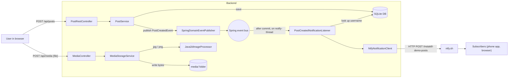
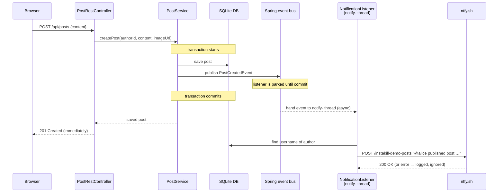
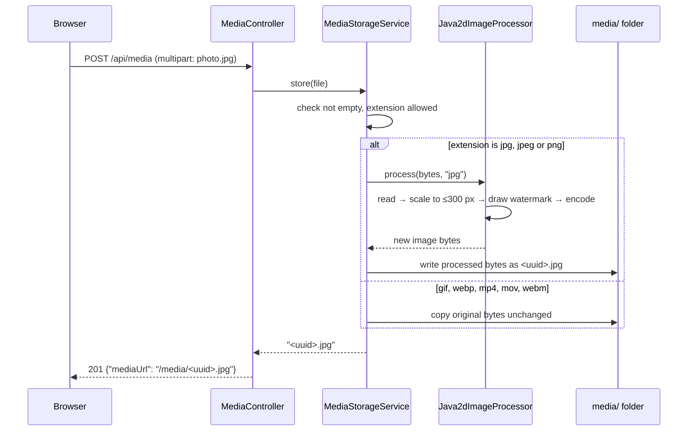

# Post Creation Notifications & Image Processing – Solution explained

> This assignment adds two "behind the scenes" features to Instakill. First, **every time someone publishes a post, the server sends a short message to a public notification service called [ntfy.sh](https://ntfy.sh)**, for example *"@alice published post 3f2a… at 2026-10-28T18:41:25Z"*. Anyone subscribed to that channel gets it on their phone or in their browser. This happens in the background, so the person posting never waits for it. Second, **every JPEG or PNG picture that is uploaded is shrunk to at most 300 pixels wide and stamped with a small "Instakill Demo" label in its bottom-right corner** before it is saved to disk. Both features are built as self-contained modules that the rest of the app talks to only through a small, clearly defined doorway.

## Table of contents

1. [The big picture](#1-the-big-picture)
2. [Background concepts you need](#2-background-concepts-you-need)
3. [What the assignment asks for](#3-what-the-assignment-asks-for)
4. [The solution, step by step](#4-the-solution-step-by-step)
   - [Part A – Post creation notifications](#part-a--post-creation-notifications)
   - [Part B – Image processing](#part-b--image-processing)
   - [Tests that were added or changed](#tests-that-were-added-or-changed)
5. [Optional extras](#5-optional-extras)
6. [Verification: bugs found and fixed, known limitations](#6-verification-bugs-found-and-fixed-known-limitations)
7. [Requirement → code checklist](#7-requirement--code-checklist)
8. [How to run and test it yourself](#8-how-to-run-and-test-it-yourself)
9. [Glossary](#9-glossary)

---

## 1. The big picture

### 1.1 What problem is being solved?

Picture a small café.

- **Notifications.** When a customer orders, the cashier shouts the order to the kitchen and then *immediately turns to the next customer*. The cashier does not walk to the kitchen and wait until the cook nods. In our app, creating a post is the order, and the notification is the shout. The server must not keep the user waiting while it talks to a service on the other side of the internet. If that service is slow or down, the user's post must still succeed.
- **Image processing.** Before a photo goes on the café's wall, someone trims it to fit the frame and stamps the café's logo in the corner. In our app, the "wall" is the `media/` folder on disk, the "frame" is a maximum width of 300 pixels, and the logo is the text "Instakill Demo".

### 1.2 The pieces involved

| Piece | What it is | Role here |
|---|---|---|
| **Browser + frontend** (`frontend/`, Vue) | The web page the user clicks on | Sends "create post" and "upload file" requests. **Unchanged** in this assignment. |
| **Backend** (`backend/`, Spring Boot, Java) | The program on the server that answers requests | All new code lives here. |
| **Database** (SQLite file `instakill.db`) | Where posts and users are stored | The post is saved here *before* any notification is sent. |
| **Disk folder** `media/` | Where uploaded files are kept | Receives the *processed* image instead of the original. |
| **ntfy.sh** | A free public "push notification" service on the internet | Receives our HTTP message and forwards it to subscribers. |

### 1.3 Architecture diagram



The two features don't depend on each other. They share only the backend they live in.

---

## 2. Background concepts you need

Read the subsections you aren't familiar with. Each one is used later.

### 2.1 Client, server and HTTP

A **server** is a program that waits for requests and answers them. A **client** is a program that sends requests: your browser, the `curl` command, or *our backend itself* when it talks to ntfy.sh.

They speak **HTTP**, a text protocol that works like a letter with an envelope:

```http
POST /instakill-demo-posts HTTP/1.1      ← method + path ("what to do, and where")
Host: ntfy.sh
Content-Type: text/plain                 ← headers: labels on the envelope
Title: New post on Instakill
Tags: camera

@alice published post 3f2a… at 2026-…    ← body: the letter itself
```

- The **method** says what kind of action it is. `GET` means "give me something" and `POST` means "here is something new".
- The **path** (`/instakill-demo-posts`) says which "window" of the server you are talking to. A (method, path) pair that the server answers is called an **endpoint**.
- **Headers** are `Name: value` labels with extra information.
- The answer carries a **status code**: `200 OK`, `201 Created`, `400 Bad Request` (your fault), `401 Unauthorized` (not logged in), `500 Internal Server Error` (server's fault).

**This assignment is unusual:** our backend is normally the *server*, but for notifications it also acts as a *client* that sends an HTTP request to another server.

### 2.2 ntfy.sh, topics and "publish/subscribe"

[ntfy.sh](https://ntfy.sh) is a free service that works like a radio station with many channels. A channel is called a **topic** and is just a name in the URL, e.g. `https://ntfy.sh/instakill-demo-posts`.

- **Publishing**: anyone who sends `POST https://ntfy.sh/<topic>` with a text body puts a message on that channel. No account is needed.
- **Subscribing**: anyone who opens `https://ntfy.sh/<topic>` in a browser, or adds the topic in the ntfy phone app, sees every message published to it.

ntfy reads a few optional headers: `Title` (bold first line of the notification) and `Tags` (names of emojis to show, e.g. `camera` → 📷).

> ⚠️ Topics are public. Whoever knows the topic name can read the messages. See [known limitations](#63-known-limitations).

### 2.3 Synchronous vs. asynchronous, threads and thread pools

A **thread** is one line of work inside a program, like one employee doing one task at a time. A Spring Boot server handles each incoming request on its own thread.

- **Synchronous** = "do it now, and I'll wait until you're done." If the request thread itself called ntfy.sh, the user would wait for ntfy's answer, possibly seconds.
- **Asynchronous** = "put it on someone else's to-do list and carry on." The request thread hands the job to *another* thread and immediately answers the user.

A **thread pool** (Spring calls it an **executor**) is a small team of worker threads plus a waiting queue of jobs. We create a team of 2 workers named `notify-1` and `notify-2`, with room for 100 waiting jobs.

### 2.4 Database transactions and "commit"

A **transaction** is a group of database changes that either all happen or none happen, like a bank transfer: money leaves one account *and* arrives in the other, or neither. **Commit** is the moment the changes become permanent. **Rollback** cancels them.

Why it matters: we only want to announce a post *after* it has really been saved. If we announced it first and the save then failed, subscribers would hear about a post that doesn't exist.

### 2.5 Events, publishers and listeners

An **event** is a small object that says "something happened", e.g. *"post X was created by user Y at time Z"*. A **publisher** announces events and **listeners** react to them. The publisher doesn't know who is listening, just as a radio host doesn't know who is tuned in.

This keeps code separated. `PostService` only says "a post was created". It knows nothing about ntfy, HTTP or notifications. We can add, remove or replace listeners without touching it.

Spring has a built-in **event bus**: you call `publishEvent(event)` and Spring calls every method that is marked as a listener for that event type.

### 2.6 Spring Boot basics: beans, annotations, dependency injection, configuration

- **Spring Boot** is the Java framework the backend uses. It starts the web server, connects to the database and wires all the parts together.
- An **annotation** is a tag in the code starting with `@`, such as `@Component`. It doesn't run anything by itself. It is a note that Spring reads at startup to decide what to do with the class or method.
- A **bean** is an object that Spring creates and manages for you. Classes tagged `@Component`, `@Service` or `@Configuration` become beans.
- **Dependency injection**: when a class's constructor asks for something, e.g. `public PostService(..., DomainEventPublisher eventPublisher)`, Spring finds the matching bean and passes it in. Nobody writes `new SpringDomainEventPublisher()` by hand. It's like a restaurant where every cook finds their ingredients already on the counter.
- An **interface** is a contract: a list of methods without their implementation. `DomainEventPublisher` says "you can call `publish(event)`" but not *how* it's done. Different classes can fulfil the same contract, which makes parts swappable.
- **Configuration properties**: settings live in [`application.yaml`](../../backend/src/main/resources/application.yaml), a **YAML** file (indented `key: value` text). A Java **record** marked `@ConfigurationProperties(prefix = "notification")` gets filled automatically with the values under `notification:`. Any value can be overridden with an environment variable, e.g. `NOTIFICATION_TOPIC=my-topic`.
- A **record** is a short way to write a Java class that just holds a few values, e.g. `record Notification(String title, String message, List<String> tags)`.

### 2.7 Images as pixels: width, height, aspect ratio, formats

A digital image is a grid of coloured dots called **pixels**. An 800 × 400 image is 800 pixels wide and 400 tall.

- **Aspect ratio** is width ÷ height (800 / 400 = 2). "Preserving the aspect ratio" means shrinking both sides by the *same factor*, so the picture isn't stretched: 800 × 400 → 300 × 150.
- **JPEG** (`.jpg`/`.jpeg`) is good for photos. It is slightly lossy and has **no transparency**.
- **PNG** is lossless and supports transparency through an **alpha channel**, a fourth value per pixel that says how see-through it is.
- **GIF** can be animated and **WebP** is a newer format. Java's built-in tools can't properly write them (see 4.B.4).

### 2.8 Java's built-in imaging: ImageIO and Java2D

Java ships with image tools, so **no extra library was needed**:

- **`ImageIO`**: reads an image file into memory (`ImageIO.read`) and writes it back out in a chosen format (`ImageIO.write`).
- **`BufferedImage`**: the in-memory pixel grid.
- **Java2D / `Graphics2D`**: a "paintbrush" for a `BufferedImage`. You can draw another image onto it (optionally resized), or draw text in a chosen font and colour.
- **Interpolation** decides how the colour of each new pixel is calculated when resizing. **Bilinear** interpolation blends the 4 nearest original pixels, which gives smoother results than just picking one.

### 2.9 Multipart upload (recap from assignment 3)

Files are uploaded with a `multipart/form-data` request, a parcel that can carry a file together with its original filename. The existing endpoint `POST /api/media` receives it and answers `201 Created` with `{"mediaUrl": "/media/<random-id>.png"}`. This assignment only changes what happens to the bytes *between receiving and saving*.

### 2.10 Tests: unit, integration and mocks

- A **unit test** checks one class on its own.
- An **integration test** starts (most of) the real application and sends it fake HTTP requests through a tool called **MockMvc**.
- A **mock** is a stand-in object that records how it was called and returns canned answers. For example, a mock `NotificationClient` lets a test check *what* would have been sent, without any real network traffic.

---

## 3. What the assignment asks for

From [`description.md`](description.md):

### Part 1 – Post creation notifications

| Requirement | In plain words | Why it exists |
|---|---|---|
| Whenever a new post is created, send an HTTP request to a public notification service (e.g. ntfy.sh) | Our server must call out to ntfy.sh every time a post is made, no matter how the post was created | The point is to practise integrating with an *external* service |
| …containing basic info about the post (username, post ID, timestamp) | The message must say who posted, which post and when | Without it the notification would be useless ("something happened") |
| The message should be formatted… | It should read nicely, with a title and readable text, not raw data | Humans read it on their phones |
| …and sent asynchronously | The user's "create post" request must not wait for ntfy.sh | ntfy.sh is on the internet: it can be slow or down, and that must never slow down or break posting |

### Part 2 – Image processing service

| Requirement | In plain words | Why it exists |
|---|---|---|
| When an image is uploaded, process it before saving | The file on disk must already be the processed version | Every viewer then sees the processed image, and storage is saved |
| Add a small watermark ("Instakill Demo") at the bottom-right | Draw that text in the corner | Marks images as belonging to this demo |
| Scale to a maximum width of 300 px, preserving aspect ratio | Shrink wide images to 300 px wide without stretching them | Smaller files and faster pages |
| Use any suitable image library | Free choice | — |
| Structure it as a separate service/module that could later run independently (message queue, background worker) | Keep the image code isolated behind a clear interface, with no ties to web/HTTP code | So it can later be moved into its own program without rewriting it |

---

## 4. The solution, step by step

Below, every change of the assignment is explained in the order that data flows through it. Files are marked **new** or **modified**.

### Part A – Post creation notifications

#### A.0 The whole flow at a glance



The key point is that the browser receives its `201 Created` without waiting for the arrows to ntfy.sh.

#### A.1 The event: `PostCreatedEvent`

**File:** [`backend/src/main/java/com/instakill/post/domain/PostCreatedEvent.java`](../../backend/src/main/java/com/instakill/post/domain/PostCreatedEvent.java) (*new*)

**What it does:** a tiny record holding the three facts about a new post: its id, its author's id and when it was created.

**Why it's needed:** it's the "message on the event bus" that lets `PostService` announce a new post without knowing about notifications. It carries exactly the "basic info" the assignment asks for.

```java
public record PostCreatedEvent(UUID postId, UUID authorId, Instant occurredAt) {
    public PostCreatedEvent {
        if (postId == null || authorId == null || occurredAt == null) {
            throw new IllegalArgumentException("postId, authorId and occurredAt must not be null");
        }
    }
}
```

- `record PostCreatedEvent(UUID postId, UUID authorId, Instant occurredAt)`: three fields. A **UUID** is a 36-character random id like `3f2a…-…`. An `Instant` is an exact moment in time (UTC).
- `public PostCreatedEvent { … }` is a *compact constructor*: code that runs every time such an event is created. It refuses incomplete events, so a listener can never receive one with a missing field.
- It mirrors the existing `LikeCreatedEvent` (from an earlier refactor), so both events look and behave the same.
- It stores the **author id, not the username**. The username is looked up later by the listener (A.6). This keeps the event small and keeps the `post` module free of user-display concerns.

#### A.2 Announcing the event: `PostService.createPost`

**File:** [`backend/src/main/java/com/instakill/post/application/PostService.java`](../../backend/src/main/java/com/instakill/post/application/PostService.java) (*modified*)

**What changed:** `PostService` now receives a `DomainEventPublisher` and publishes a `PostCreatedEvent` right after saving a post.

**Why it's needed:** `createPost` is the **single place** where posts are created. The REST API (`PostRestController`), the server-rendered web pages (`PostWebController`) and the demo-data seeder (`DataInitializer`) all call it. Hooking in here guarantees that *every* new post triggers a notification, whatever way it was created.

```java
    private final FeedService feedService;
    private final DomainEventPublisher eventPublisher;

    public PostService(PostRepository posts,
                       IdGenerator idGenerator,
                       Clock clock,
                       FeedService feedService,
                       DomainEventPublisher eventPublisher) {
        // ...
        this.eventPublisher = eventPublisher;
    }

    @Transactional
    public Post createPost(UUID authorId, String content, String imageUrl) {
        // ... builds the Post object ...
        Post saved = posts.save(post);
        eventPublisher.publish(new PostCreatedEvent(saved.id(), saved.authorId(), saved.createdAt()));
        return saved;
    }
```

1. The constructor gained a fifth parameter. Through dependency injection, Spring passes in the event publisher bean (A.3).
2. `@Transactional` (already there) means the whole method runs inside one database transaction. The commit happens *after* the method returns.
3. **Before**, the method ended with `return posts.save(post);`. **Now** it keeps the saved post in a variable, publishes the event with the saved post's id, author and creation time, and then returns.
4. The event is published *inside* the transaction, before the commit. Section A.6 explains how the listener nevertheless waits for the commit.

#### A.3 A real publisher: `SpringDomainEventPublisher`

**File:** [`backend/src/main/java/com/instakill/infrastructure/events/SpringDomainEventPublisher.java`](../../backend/src/main/java/com/instakill/infrastructure/events/SpringDomainEventPublisher.java) (*new*)

**What it does:** implements the project's `DomainEventPublisher` interface by forwarding every event to Spring's built-in event bus.

**Why it's needed:** before this assignment, the only implementation was `NoOpDomainEventPublisher`, which throws events away. Nobody could react to them, so a real publisher was required.

```java
@Component
public class SpringDomainEventPublisher implements DomainEventPublisher {

    private final ApplicationEventPublisher applicationEventPublisher;

    public SpringDomainEventPublisher(ApplicationEventPublisher applicationEventPublisher) {
        this.applicationEventPublisher = applicationEventPublisher;
    }

    @Override
    public void publish(Object event) {
        applicationEventPublisher.publishEvent(event);
    }
}
```

- `@Component` turns the class into a bean, so Spring can inject it wherever a `DomainEventPublisher` is asked for (in `PostService` and the existing `InteractionService`).
- `implements DomainEventPublisher` means it fulfils the project's contract: one method, `publish(Object event)`.
- `ApplicationEventPublisher` is Spring's own event bus, injected through the constructor.
- `publish` passes the event on to Spring. That's all. It's an *adapter* between the project's interface and Spring's mechanism.
- It lives in `infrastructure/`, the package for "technical wiring". The domain code depends only on the interface, never on Spring's event classes.

#### A.4 Retiring the no-op publisher as a bean

**File:** [`backend/src/main/java/com/instakill/interaction/domain/NoOpDomainEventPublisher.java`](../../backend/src/main/java/com/instakill/interaction/domain/NoOpDomainEventPublisher.java) (*modified*)

**What changed:** the `@Component` annotation (and its import) was removed.

```java
public class NoOpDomainEventPublisher implements DomainEventPublisher {

    @Override
    public void publish(Object event) {
        // Intentionally does nothing.
    }
}
```

**Why:** if *two* beans implement `DomainEventPublisher`, Spring can't decide which one to inject and the app fails to start with a "found 2 beans" error. Without `@Component`, the no-op class is just a plain class again. It's kept because the existing `InteractionServiceTest` creates it by hand with `new NoOpDomainEventPublisher()`.

Side effect worth knowing: `InteractionService` already publishes `LikeCreatedEvent`, and that event now also reaches Spring's bus. Nobody listens to it yet, so nothing changes in behaviour.

#### A.5 A background team: `AsyncConfig`

**File:** [`backend/src/main/java/com/instakill/infrastructure/config/AsyncConfig.java`](../../backend/src/main/java/com/instakill/infrastructure/config/AsyncConfig.java) (*new*)

**What it does:** switches on Spring's "run this method in the background" feature and creates a dedicated pool of two worker threads for notifications.

**Why it's needed:** this is the "asynchronously" requirement. Something has to actually run the notification work off the request thread.

```java
@Configuration
@EnableAsync
public class AsyncConfig {

    public static final String NOTIFICATION_EXECUTOR = "notificationExecutor";

    @Bean(name = NOTIFICATION_EXECUTOR)
    public ThreadPoolTaskExecutor notificationExecutor() {
        ThreadPoolTaskExecutor executor = new ThreadPoolTaskExecutor();
        executor.setCorePoolSize(2);
        executor.setMaxPoolSize(2);
        executor.setQueueCapacity(100);
        executor.setThreadNamePrefix("notify-");
        executor.initialize();
        return executor;
    }
}
```

1. `@Configuration` marks a class that *creates* beans.
2. `@EnableAsync` turns on support for the `@Async` annotation (used in A.6). Without it, `@Async` would be silently ignored and everything would run synchronously.
3. `NOTIFICATION_EXECUTOR` is a constant name, so the listener can refer to this exact pool without typos.
4. `@Bean(name = …)` means "the object this method returns is a bean called `notificationExecutor`".
5. `setCorePoolSize(2)` / `setMaxPoolSize(2)`: always exactly two worker threads. Notifications are tiny, so two are plenty.
6. `setQueueCapacity(100)`: up to 100 jobs can wait in line if both workers are busy.
7. `setThreadNamePrefix("notify-")`: workers are called `notify-1` and `notify-2`. That name shows up in the logs, which is how you can *see* the work happening off the request thread (see chapter 6).
8. `initialize()` starts the pool.

Why a *dedicated* pool instead of Spring's default? It isolates notifications. If ntfy.sh becomes very slow, only these two threads are tied up, and nothing else in the app competes with them.

#### A.6 Reacting to the event: `PostCreatedNotificationListener`

**File:** [`backend/src/main/java/com/instakill/notification/PostCreatedNotificationListener.java`](../../backend/src/main/java/com/instakill/notification/PostCreatedNotificationListener.java) (*new*)

**What it does:** waits for `PostCreatedEvent`s, builds a human-readable message and hands it to the notification client.

**Why it's needed:** this class connects "a post was created" to "send a notification", and it is where the timing (after commit, in the background) and the formatting are decided.

```java
@Component
public class PostCreatedNotificationListener {

    private final NotificationClient client;
    private final UserRepository users;
    private final NotificationProperties properties;

    // ... constructor stores the three dependencies ...

    /**
     * Runs on a background thread, only after the post's transaction has committed.
     */
    @Async(AsyncConfig.NOTIFICATION_EXECUTOR)
    @TransactionalEventListener(phase = TransactionPhase.AFTER_COMMIT, fallbackExecution = true)
    public void onPostCreated(PostCreatedEvent event) {
        if (!properties.enabled()) {
            return;
        }
        client.send(format(event));
    }

    Notification format(PostCreatedEvent event) {
        String username = users.findById(event.authorId())
                .map(User::username)
                .orElse("unknown user");
        String message = "@" + username + " published post " + event.postId() + " at " + event.occurredAt();
        return new Notification("New post on Instakill", message, List.of("camera"));
    }
}
```

The two annotations on `onPostCreated` carry most of the design:

1. **`@TransactionalEventListener(phase = TransactionPhase.AFTER_COMMIT, …)`**
   - It makes the method a listener for the event type in its parameter (`PostCreatedEvent`).
   - `AFTER_COMMIT` means: *"don't call me when the event is published; call me only once the surrounding transaction has committed."* When `PostService` publishes the event mid-transaction, Spring parks it, and delivers it only if the save actually becomes permanent. If the transaction is rolled back, the listener never runs, so no notification goes out for a post that doesn't exist.
   - `fallbackExecution = true`: if an event is ever published *outside* any transaction, still deliver it (immediately) instead of silently dropping it. Today `createPost` is always transactional, so this is a safety net.
2. **`@Async(AsyncConfig.NOTIFICATION_EXECUTOR)`**
   - Instead of running the method on the current thread, Spring puts a job on the `notificationExecutor` queue (A.5) and returns at once.
   - Combined with the first annotation: *after the commit, hand the work to a `notify-` worker.* The request thread is free to send `201 Created` to the browser.

The method body:

3. `if (!properties.enabled()) return;` is an on/off switch from configuration (A.8). Tests turn it off so they never contact the real internet.
4. `client.send(format(event))` builds the message and sends it.

The `format` method:

5. `users.findById(event.authorId())` looks up the author in the database. It returns an `Optional<User>`, a box that may be empty.
6. `.map(User::username)`: if a user is in the box, take their username.
7. `.orElse("unknown user")`: if the box is empty (e.g. the user was deleted meanwhile), use a fallback text instead of crashing.
8. The message becomes, for example:
   `@alice published post 9e8f1b11-ca6b-488b-8057-5402627adeaa at 2026-10-28T18:41:25.412200514Z`
   This contains **username, post ID and timestamp**, exactly what the assignment asked for. The timestamp is in ISO-8601 format in UTC (the `Z` at the end means UTC).
9. `new Notification("New post on Instakill", message, List.of("camera"))`: a title, the message and one ntfy tag, `camera`, which ntfy shows as a 📷 emoji. That's the "formatted" part.

`format` has no `public` keyword (package-private), so it can be used by the test in the same package but isn't part of the class's public face.

**What if something goes wrong?** Any problem here happens on a `notify-` thread *after* the user already got their answer, so it can never turn a successful post into an error. Network problems are handled one level down (A.7).

#### A.7 Talking to ntfy.sh: `NotificationClient`, `Notification`, `NtfyNotificationClient`

**Files** (all *new*):
- [`backend/src/main/java/com/instakill/notification/NotificationClient.java`](../../backend/src/main/java/com/instakill/notification/NotificationClient.java)
- [`backend/src/main/java/com/instakill/notification/Notification.java`](../../backend/src/main/java/com/instakill/notification/Notification.java)
- [`backend/src/main/java/com/instakill/notification/NtfyNotificationClient.java`](../../backend/src/main/java/com/instakill/notification/NtfyNotificationClient.java)

**What they do:** define *what* a notification is and *how* to deliver one, and then implement the delivery for ntfy.sh.

```java
public interface NotificationClient {
    void send(Notification notification);
}
```

```java
public record Notification(String title, String message, List<String> tags) {
}
```

- `NotificationClient` is the contract. The listener only knows "something can `send` a notification". Switching to another service (Slack, e-mail…) would mean writing a new class that implements this interface, with no change to the listener. It also makes testing easy: the test passes a mock.
- `Notification` is a plain data holder that has nothing to do with ntfy.

```java
@Component
public class NtfyNotificationClient implements NotificationClient {

    private static final Logger log = LoggerFactory.getLogger(NtfyNotificationClient.class);

    private final RestClient restClient;
    private final String topic;

    public NtfyNotificationClient(RestClient.Builder restClientBuilder, NotificationProperties properties) {
        this.restClient = restClientBuilder.baseUrl(properties.baseUrl()).build();
        this.topic = properties.topic();
    }

    @Override
    public void send(Notification notification) {
        try {
            restClient.post()
                    .uri("/{topic}", topic)
                    .contentType(MediaType.TEXT_PLAIN)
                    .header("Title", notification.title())
                    .header("Tags", String.join(",", notification.tags()))
                    .body(notification.message())
                    .retrieve()
                    .toBodilessEntity();
            log.info("Sent notification to ntfy topic '{}': {}", topic, notification.message());
        } catch (RestClientException e) {
            // A failed notification must never affect the user's request.
            log.warn("Could not send notification to ntfy topic '{}': {}", topic, e.getMessage());
        }
    }
}
```

1. `Logger log` writes lines to the server's console/log file.
2. **`RestClient`** is Spring's tool for *sending* HTTP requests (our backend acting as a client). It comes with `spring-boot-starter-web`, which the project already had, so **no new dependency** was needed.
3. In the constructor, Spring injects a ready-made `RestClient.Builder`. We set the **base URL** (`https://ntfy.sh` from the configuration) and build the client once, to reuse for every notification.
4. `send` builds the HTTP request piece by piece:
   - `.post()` → method `POST`.
   - `.uri("/{topic}", topic)` → path `/instakill-demo-posts`. `{topic}` is a placeholder that Spring fills in and safely escapes.
   - `.contentType(MediaType.TEXT_PLAIN)` → header `Content-Type: text/plain`: "the body is plain text".
   - `.header("Title", …)` and `.header("Tags", …)` → ntfy's special headers. Tags are joined with commas (`camera`).
   - `.body(notification.message())` → the message text as the body.
   - `.retrieve().toBodilessEntity()` → actually send it and wait (on the `notify-` thread, not the user's) for the status code. We don't need ntfy's response body. If the status is an error (4xx/5xx), this throws an exception.
5. `catch (RestClientException e)`: every network problem (server unreachable, timeout, error status) becomes a `RestClientException`. We **log a warning and carry on**. A missed notification is not worth crashing anything.

The full request ntfy.sh receives looks like this (captured during verification with a local stand-in server):

```http
POST /instakill-demo-posts HTTP/1.1
Content-Type: text/plain
Title: New post on Instakill
Tags: camera

@alice published post 97f58cc9-0a47-4b76-bfb8-2f1d9111c8e8 at 2026-10-28T18:41:16.923351050Z
```

#### A.8 Settings: `NotificationProperties` and the YAML files

**File:** [`backend/src/main/java/com/instakill/notification/NotificationProperties.java`](../../backend/src/main/java/com/instakill/notification/NotificationProperties.java) (*new*)

```java
@ConfigurationProperties(prefix = "notification")
public record NotificationProperties(
        @DefaultValue("true") boolean enabled,
        @DefaultValue("https://ntfy.sh") String baseUrl,
        @DefaultValue("instakill-demo-posts") String topic
) {
}
```

- `@ConfigurationProperties(prefix = "notification")` tells Spring to fill this record from the `notification:` section of the configuration. The app class already has `@ConfigurationPropertiesScan`, which makes Spring find it automatically.
- `@DefaultValue(...)` is used if the setting is missing.
- YAML uses `base-url` and Java uses `baseUrl`. Spring matches them up ("relaxed binding"). The same goes for environment variables: `NOTIFICATION_BASEURL`, `NOTIFICATION_TOPIC`, `NOTIFICATION_ENABLED`.

**File:** [`backend/src/main/resources/application.yaml`](../../backend/src/main/resources/application.yaml) (*modified*, the `notification:` part)

```yaml
notification:
  enabled: true
  base-url: https://ntfy.sh
  topic: instakill-demo-posts
```

**File:** [`backend/src/test/resources/application-test.yaml`](../../backend/src/test/resources/application-test.yaml) (*modified*)

```yaml
notification:
  enabled: false
```

**Why:** the automated tests run with the `test` profile, which loads this extra file on top. Turning notifications off there means running the tests never sends real messages to the public internet. That keeps tests fast, reliable offline and polite to ntfy.sh.

---

### Part B – Image processing

#### B.0 The upload flow at a glance



If the bytes aren't a real image (e.g. a text file renamed to `.png`), the processor throws an error and the browser gets `400 Bad Request` with the detail `"Not a valid image"`. Nothing is written to disk.

#### B.1 The contract: `ImageProcessor`

**File:** [`backend/src/main/java/com/instakill/imageprocessing/ImageProcessor.java`](../../backend/src/main/java/com/instakill/imageprocessing/ImageProcessor.java) (*new*)

**What it does:** defines the one thing the image module can do: take image bytes in, give processed image bytes out.

**Why it's needed:** this is the answer to *"structure it as a separate service or module that could later run independently"*.

```java
/**
 * Transforms an uploaded image before it is stored.
 * Kept free of web concerns so it could later run in a separate worker (e.g. behind a message queue).
 */
public interface ImageProcessor {

    /**
     * @param in     the original image bytes
     * @param format the output format, e.g. "png" or "jpg"
     * @return the processed image encoded in {@code format}
     */
    byte[] process(InputStream in, String format);
}
```

- The input is an `InputStream` (a stream of bytes) and the output is a `byte[]`. **Nothing here mentions HTTP, uploads, `MultipartFile` or the disk.** "Bytes in, bytes out" is exactly the kind of job that could be put on a **message queue** and done by a separate worker program later. Only the class that *calls* `process` would change.
- The module lives in its own top-level package, `com.instakill.imageprocessing`, next to (not inside) `media`, and imports nothing from the web layer.

#### B.2 Settings: `ImageProcessingProperties` and YAML

**File:** [`backend/src/main/java/com/instakill/imageprocessing/ImageProcessingProperties.java`](../../backend/src/main/java/com/instakill/imageprocessing/ImageProcessingProperties.java) (*new*)

```java
@ConfigurationProperties(prefix = "image-processing")
public record ImageProcessingProperties(
        @DefaultValue("300") int maxWidth,
        @DefaultValue("Instakill Demo") String watermarkText
) {
}
```

**File:** [`backend/src/main/resources/application.yaml`](../../backend/src/main/resources/application.yaml) (*modified*, the `image-processing:` part)

```yaml
image-processing:
  max-width: 300
  watermark-text: Instakill Demo
```

This works the same way as A.8. The 300 px limit and the watermark text are **settings, not hard-coded numbers**, so they can be changed without touching Java code (e.g. `IMAGE_PROCESSING_MAXWIDTH=600`).

#### B.3 The worker: `Java2dImageProcessor`

**File:** [`backend/src/main/java/com/instakill/imageprocessing/Java2dImageProcessor.java`](../../backend/src/main/java/com/instakill/imageprocessing/Java2dImageProcessor.java) (*new*; the watermark sizing was fixed during verification, see [6.2](#62-bugs-found-and-fixed))

**What it does:** implements `ImageProcessor` with Java's built-in ImageIO + Java2D.

**Why this library:** it ships with Java, so the build needs no extra download, and it handles JPEG and PNG, the two common photo formats.

##### The main recipe

```java
@Component
public class Java2dImageProcessor implements ImageProcessor {

    private static final int PADDING = 8;
    private static final int MIN_FONT_SIZE = 10;

    private final int maxWidth;
    private final String watermarkText;

    public Java2dImageProcessor(ImageProcessingProperties properties) {
        this.maxWidth = properties.maxWidth();
        this.watermarkText = properties.watermarkText();
    }

    @Override
    public byte[] process(InputStream in, String format) {
        BufferedImage source = read(in);
        boolean opaque = isJpeg(format);
        BufferedImage result = scale(source, opaque);
        drawWatermark(result);
        return write(result, format);
    }
```

- `PADDING = 8`: the watermark sits 8 px away from the right and bottom edges.
- `MIN_FONT_SIZE = 10`: the preferred minimum text size.
- `process` is a four-step recipe: **read → scale → watermark → write**.
- `opaque` is true for JPEG, which can't store transparency (see the `scale` step).
- **Order matters:** the watermark is drawn *after* scaling. If it were drawn on a 4000 px original and then shrunk 13×, it would become an unreadable smudge.

##### Step 1: read

```java
    private BufferedImage read(InputStream in) {
        try {
            BufferedImage image = ImageIO.read(in);
            if (image == null) {
                throw new BadRequestException("Not a valid image");
            }
            return image;
        } catch (IOException e) {
            throw new BadRequestException("Not a valid image");
        }
    }
```

- `ImageIO.read` decodes the bytes into a pixel grid. It looks at the *content*, not the filename, so a JPEG that was named `.png` is still read correctly.
- If the bytes aren't an image it knows, it returns `null`. A damaged file makes it throw an `IOException`. **Both become a `BadRequestException`**, which the project's existing `RestExceptionHandler` turns into **HTTP 400** with the message "Not a valid image". It's the uploader's fault, not the server's, so 400 (not 500) is the right answer.

##### Step 2: scale

```java
    private BufferedImage scale(BufferedImage source, boolean opaque) {
        int width = source.getWidth();
        int height = source.getHeight();
        if (width > maxWidth) {
            height = Math.max(1, Math.round((float) height * maxWidth / width));
            width = maxWidth;
        }
        // JPEG has no alpha channel, so draw onto an RGB canvas with a white background.
        BufferedImage target = new BufferedImage(width, height,
                opaque ? BufferedImage.TYPE_INT_RGB : BufferedImage.TYPE_INT_ARGB);
        Graphics2D g = target.createGraphics();
        try {
            g.setRenderingHint(RenderingHints.KEY_INTERPOLATION, RenderingHints.VALUE_INTERPOLATION_BILINEAR);
            g.setRenderingHint(RenderingHints.KEY_RENDERING, RenderingHints.VALUE_RENDER_QUALITY);
            if (opaque) {
                g.setColor(Color.WHITE);
                g.fillRect(0, 0, width, height);
            }
            g.drawImage(source, 0, 0, width, height, null);
        } finally {
            g.dispose();
        }
        return target;
    }
```

1. **Only shrink, never enlarge.** If the image is already ≤ 300 px wide, `width` and `height` stay as they are. Enlarging a small image would only make it blurry.
2. **Preserving the aspect ratio**: new height = old height × 300 / old width. For 2000 × 1000: 1000 × 300 / 2000 = **150** → 300 × 150.
   - `(float)` makes Java do decimal division instead of whole-number division, which would throw away fractions too early. `Math.round` then rounds to the nearest whole pixel.
   - `Math.max(1, …)` makes sure an extremely wide, flat image (e.g. 5000 × 10) never ends up 0 px tall, which would crash.
3. A **new, empty canvas** of the target size is created:
   - `TYPE_INT_RGB` (red, green, blue) for JPEG.
   - `TYPE_INT_ARGB` (alpha + RGB) for PNG, so transparent areas stay transparent.
4. `createGraphics()` gives the paintbrush. The two "rendering hints" ask for smooth **bilinear** resizing and quality over speed.
5. For JPEG, the canvas is first painted white, so any transparent parts of a source image become white rather than black.
6. `g.drawImage(source, 0, 0, width, height, null)` draws the original **stretched to the new size** from the top-left corner (0, 0). This single call does the actual resize.
7. `finally { g.dispose(); }` always releases the paintbrush's resources, even if something fails.

The processing also normalizes unusual inputs. Grayscale JPEGs, palette PNGs and even CMYK JPEGs (print colours) were tested and all come out as standard RGB/ARGB images.

##### Step 3: watermark

```java
    private void drawWatermark(BufferedImage image) {
        Graphics2D g = image.createGraphics();
        try {
            g.setRenderingHint(RenderingHints.KEY_TEXT_ANTIALIASING, RenderingHints.VALUE_TEXT_ANTIALIAS_ON);
            int fontSize = Math.max(MIN_FONT_SIZE, image.getWidth() / 20);
            int available = image.getWidth() - 2 * PADDING;
            // Very narrow images: shrink the text so all of it stays inside the image.
            while (fontSize > 1 && g.getFontMetrics(watermarkFont(fontSize)).stringWidth(watermarkText) > available) {
                fontSize--;
            }
            g.setFont(watermarkFont(fontSize));
            FontMetrics metrics = g.getFontMetrics();
            if (metrics.stringWidth(watermarkText) > available) {
                return; // too small for any readable watermark
            }
            int x = image.getWidth() - metrics.stringWidth(watermarkText) - PADDING;
            int y = image.getHeight() - metrics.getDescent() - PADDING;

            g.setComposite(AlphaComposite.getInstance(AlphaComposite.SRC_OVER, 0.7f));
            // Dark shadow first so the white text stays readable on light images.
            g.setColor(Color.BLACK);
            g.drawString(watermarkText, x + 1, y + 1);
            g.setColor(Color.WHITE);
            g.drawString(watermarkText, x, y);
        } finally {
            g.dispose();
        }
    }

    private static Font watermarkFont(int size) {
        return new Font(Font.SANS_SERIF, Font.BOLD, size);
    }
```

1. **Anti-aliasing** smooths the jagged edges of the letters.
2. **Choosing the size, so the watermark stays "small":**
   - The start is 1/20 of the image width, at least 10 px. A 300 px image gets 15 px text and a 200 px image gets 10 px text, so the label is proportionally small.
   - `available` is the width the text may use: image width minus 8 px padding on each side.
   - The `while` loop handles **very narrow images**. If the text at that size is wider than `available`, the font is made 1 px smaller and measured again, until it fits. A 60 px-wide image therefore gets tiny but *complete* text instead of a cut-off one.
   - If even 1 px text can't fit (e.g. a 1 × 1 image), the method returns without drawing anything. A watermark there would be meaningless.
3. **`FontMetrics`** gives the exact size of the text in this font: `stringWidth` is how wide it is, and `getDescent` is how far letters like "p" or "g" hang below the baseline.
4. **Placing it bottom-right:**
   - `x = image width − text width − 8`: the text *ends* 8 px before the right edge.
   - `y = image height − descent − 8`: text is drawn from its **baseline** (the line letters sit on), so the descent is subtracted to keep the lower parts of letters inside too.
5. **Readable on any background:**
   - `AlphaComposite … 0.7f` paints at 70 % opacity, so the image shows through slightly. That's typical for watermarks.
   - First a **black copy shifted 1 px right and down** (a drop shadow), then the **white text** on top. White on a dark photo and the black outline on a light photo both stay readable.

##### Step 4: write

```java
    private byte[] write(BufferedImage image, String format) {
        ByteArrayOutputStream out = new ByteArrayOutputStream();
        try {
            if (!ImageIO.write(image, format, out)) {
                throw new BadRequestException("Unsupported image format: " + format);
            }
        } catch (IOException e) {
            throw new UncheckedIOException("Could not encode image", e);
        }
        return out.toByteArray();
    }

    private static boolean isJpeg(String format) {
        String f = format.toLowerCase(Locale.ROOT);
        return f.equals("jpg") || f.equals("jpeg");
    }
```

- `ImageIO.write` encodes the pixel grid as JPEG or PNG into an in-memory byte buffer (`ByteArrayOutputStream`). It returns `false` if it has no encoder for the format. That can't happen with how `MediaStorageService` calls it (only jpg/jpeg/png), but it's turned into a clear 400 just in case.
- An `IOException` while encoding would be a server-side problem, so it becomes an `UncheckedIOException` → 500.
- The result is the new image's bytes, ready to save. As a side effect, metadata stored in the original (such as EXIF camera/GPS data) is **not copied** into the new file.
- `isJpeg` is a small helper that ignores upper/lower case.

#### B.4 Plugging it into uploads: `MediaStorageService`

**File:** [`backend/src/main/java/com/instakill/media/application/MediaStorageService.java`](../../backend/src/main/java/com/instakill/media/application/MediaStorageService.java) (*modified*)

**What changed:** it now receives an `ImageProcessor` and, for JPEG/PNG files, saves the processed bytes instead of the original ones.

**Why it's needed:** `store` is the **only** place where uploaded bytes are written to disk, so it's the single right spot to guarantee "process before saving".

```java
    /** Formats the image processor can read and write; anything else (videos, gif, webp) is stored as-is. */
    private static final Set<String> PROCESSED_IMAGE_EXTENSIONS = Set.of("jpg", "jpeg", "png");

    // ...
    private final ImageProcessor imageProcessor;

    public MediaStorageService(MediaProperties properties, IdGenerator idGenerator, ImageProcessor imageProcessor) {
        // ...
        this.imageProcessor = imageProcessor;
        // ...
    }

    /**
     * Stores the file under the media base path and returns its public filename.
     * JPEG and PNG images are scaled down and watermarked before saving.
     */
    public String store(MultipartFile file) {
        // ... existing checks: not empty, extension allowed ...
        String normalizedExtension = extension.toLowerCase(Locale.ROOT);
        String filename = idGenerator.generate() + "." + normalizedExtension;
        Path target = baseDir.resolve(filename);
        try (InputStream in = file.getInputStream()) {
            Files.createDirectories(baseDir);
            if (PROCESSED_IMAGE_EXTENSIONS.contains(normalizedExtension)) {
                Files.write(target, imageProcessor.process(in, normalizedExtension));
            } else {
                Files.copy(in, target, StandardCopyOption.REPLACE_EXISTING);
            }
        } catch (IOException e) {
            throw new UncheckedIOException("Could not store file", e);
        }
        return filename;
    }
```

1. `PROCESSED_IMAGE_EXTENSIONS` lists the formats that are processed. The app also *allows* `gif`, `webp`, `mp4`, `mov` and `webm` uploads (from assignment 3), but:
   - videos aren't images, so there's nothing to scale with an image library;
   - Java's built-in ImageIO **can't write WebP** at all, and would turn an **animated GIF** into a single still frame.

   Those files are therefore stored unchanged, exactly as before, rather than broken.
2. The constructor takes the `ImageProcessor` **interface**, not the `Java2dImageProcessor` class. Spring injects the only implementation. `MediaStorageService` never knows *how* images are processed.
3. `normalizedExtension` is the lower-cased extension computed once, so `PHOTO.PNG` is treated as `png`. Before, the lower-casing happened inline in the filename line.
4. **The core change:** before, there was only `Files.copy(in, target, …)`, which streams the uploaded bytes straight to disk. Now:
   - for jpg/jpeg/png → `imageProcessor.process(in, normalizedExtension)` returns new bytes, and `Files.write` saves them;
   - for anything else → the old `Files.copy`.
5. If `process` throws `BadRequestException` ("Not a valid image"), it happens **before** `Files.write`, so no broken or half-written file is left on disk.
6. The file keeps its extension, so `/media/<uuid>.jpg` is still served with the right `Content-Type: image/jpeg` by the existing static-file setup.

---

### Tests that were added or changed

All tests live under `backend/src/test/java/com/instakill/`.

#### `Java2dImageProcessorTest` (*new*, unit test)

**File:** [`backend/src/test/java/com/instakill/imageprocessing/Java2dImageProcessorTest.java`](../../backend/src/test/java/com/instakill/imageprocessing/Java2dImageProcessorTest.java)

The tests generate images in memory (solid blue rectangles), run them through the processor and inspect the result.

```java
    @Test
    void drawsWatermarkInBottomRightCornerOnly() throws IOException {
        BufferedImage result = process(solidImage(600, 400), "png");

        assertThat(countChangedPixels(result, 150, 150, 150, 50)).isPositive();
        assertThat(countChangedPixels(result, 0, 0, 150, 100)).isZero();
    }

    @Test
    void shrinksWatermarkToFitOnNarrowImages() throws IOException {
        BufferedImage result = process(solidImage(60, 40), "png");

        assertThat(countChangedPixels(result, 0, 0, 8, 40)).isZero();
        assertThat(countChangedPixels(result, 8, 0, 52, 40)).isPositive();
    }
```

| Test | What it proves |
|---|---|
| `scalesWideImageToMaxWidthPreservingAspectRatio` | 1200 × 600 → 300 × 150 |
| `doesNotUpscaleSmallImages` | 200 × 100 stays 200 × 100 |
| `drawsWatermarkInBottomRightCornerOnly` | After scaling 600×400 to 300×150, pixels in the bottom-right area differ from the blue background (text is there) and the top-left area is untouched |
| `shrinksWatermarkToFitOnNarrowImages` | **Regression test for the bug in 6.2**: on a 60 px-wide image, the left 8 px padding stays untouched (text isn't cut off at the edge) while text is drawn elsewhere |
| `handlesJpeg` | 900 × 300 JPEG → 300 × 100 and still decodes as an image |
| `rejectsBytesThatAreNotAnImage` | Random bytes → `BadRequestException` |

`countChangedPixels` counts pixels in a rectangle whose colour differs noticeably from the background, which is a simple way to "see" the watermark in a test.

#### `MediaUploadIntegrationTest` (*modified*, integration test)

**File:** [`backend/src/test/java/com/instakill/media/MediaUploadIntegrationTest.java`](../../backend/src/test/java/com/instakill/media/MediaUploadIntegrationTest.java)

Two tests were added, using the full app through MockMvc (with a logged-in user's cookie):

```java
    @Test
    void uploadedImageIsScaledDownBeforeSaving() throws Exception {
        ByteArrayOutputStream png = new ByteArrayOutputStream();
        ImageIO.write(new BufferedImage(800, 400, BufferedImage.TYPE_INT_RGB), "png", png);
        MockMultipartFile file = new MockMultipartFile("file", "photo.png", "image/png", png.toByteArray());

        MvcResult result = mockMvc.perform(multipart("/api/media").file(file).cookie(token))
                .andExpect(status().isCreated())
                .andReturn();

        String mediaUrl = objectMapper.readTree(result.getResponse().getContentAsString()).get("mediaUrl").asText();
        byte[] stored = mockMvc.perform(get(mediaUrl))
                .andExpect(status().isOk())
                .andReturn().getResponse().getContentAsByteArray();
        BufferedImage image = ImageIO.read(new ByteArrayInputStream(stored));
        assertThat(image.getWidth()).isEqualTo(300);
        assertThat(image.getHeight()).isEqualTo(150);
    }

    @Test
    void rejectsInvalidImageContent() throws Exception {
        MockMultipartFile file = new MockMultipartFile("file", "fake.png", "image/png", "not-an-image".getBytes());
        mockMvc.perform(multipart("/api/media").file(file).cookie(token))
                .andExpect(status().isBadRequest());
    }
```

- The first test checks the whole path end to end: upload a real 800 × 400 PNG → `201` → download the file from the returned URL → it is 300 × 150. That proves the file *on disk* is the processed one.
- The second test checks that a fake `.png` results in `400 Bad Request`, not a crash.
- The existing `uploadedFileIsServedFromMediaPath` test (uploading `clip.mp4` and getting the **exact same bytes** back) still passes. That confirms non-images are untouched.

#### `PostServiceTest` (*new*, unit test)

**File:** [`backend/src/test/java/com/instakill/post/application/PostServiceTest.java`](../../backend/src/test/java/com/instakill/post/application/PostServiceTest.java)

```java
    @Test
    void createPostPublishesPostCreatedEvent() {
        UUID postId = UUID.randomUUID();
        UUID authorId = UUID.randomUUID();
        Instant now = Instant.parse("2024-01-01T00:00:00Z");
        when(idGenerator.generate()).thenReturn(postId);
        when(clock.now()).thenReturn(now);
        when(postRepository.save(any(Post.class))).thenAnswer(invocation -> invocation.getArgument(0));

        Post post = service.createPost(authorId, "hello", null);

        assertThat(post.id()).isEqualTo(postId);
        verify(eventPublisher).publish(new PostCreatedEvent(postId, authorId, now));
    }
```

All collaborators are mocks. The ID generator and clock return fixed values, and the repository simply returns what it was given. The test then checks that **exactly** `PostCreatedEvent(postId, authorId, now)` was published. Records compare by their field values, so `verify(...)` can match the event precisely.

#### `PostCreatedNotificationListenerTest` (*new*, unit test)

**File:** [`backend/src/test/java/com/instakill/notification/PostCreatedNotificationListenerTest.java`](../../backend/src/test/java/com/instakill/notification/PostCreatedNotificationListenerTest.java)

| Test | What it proves |
|---|---|
| `sendsMessageWithUsernamePostIdAndTimestamp` | With user "alice", the sent notification has title "New post on Instakill" and message exactly `@alice published post <id> at 2024-01-01T12:30:00Z` |
| `fallsBackWhenAuthorIsUnknown` | A missing user gives `@unknown user published post …` instead of a crash |
| `doesNothingWhenDisabled` | With `enabled=false`, neither the client nor the database is touched |

An `ArgumentCaptor` "catches" the `Notification` object passed to the mock client so the test can inspect it.

Note: these are unit tests that call `onPostCreated` directly, so they test the *content*, not the *timing*. The background/after-commit behaviour was verified live (chapter 6).

---

## 5. Optional extras

The description has no separately labelled optional part. The closest is the *encouraged* point "structure it as a separate service or module that could later run independently". Here is what was done for it, and what wasn't:

- **Done:** image processing is its own package (`com.instakill.imageprocessing`) behind a "bytes in → bytes out" interface (`ImageProcessor`), configured by its own properties and with no dependency on web classes. Notifications are similarly isolated (`com.instakill.notification`) and are triggered only through an event, so `PostService` doesn't know they exist.
- **Not done (deliberately):** the image processing still runs *inside* the upload request, *synchronously*. The user waits a fraction of a second while their image is processed. No actual message queue or separate worker process was set up. The design makes that a contained change: a queue-based version would implement or call `ImageProcessor` from a worker, and only `MediaStorageService` would need to change.
- Not requested but useful: both features are **configurable** (`image-processing.*`, `notification.*`), and notifications can be switched off entirely.

---

## 6. Verification: bugs found and fixed, known limitations

### 6.1 How it was verified

1. **Automated tests:** `./gradlew test` was run before and after the fix. **Final result: 30 tests, 0 failures, 0 errors** across 9 test classes (including the 16 new or changed tests described above).
2. **Frontend build:** `npx vite build` succeeds. The frontend wasn't changed in this assignment.
3. **Live server checks.** The real app (`./gradlew bootRun`) was started on a separate port, with a throw-away database and media folder so no real data was touched. `NOTIFICATION_BASEURL` pointed to a small local HTTP server that **recorded every request it received**, standing in for ntfy.sh. Results:

| Check | Result |
|---|---|
| Fresh database → demo data seeded (6 posts) | 6 notifications arrived, each `POST /<topic>` with `Content-Type: text/plain`, `Title: New post on Instakill`, `Tags: camera` and the body `@alice published post <uuid> at <timestamp>` |
| Logs show which thread sends | `[notify-1]` / `[notify-2]` (not the web request thread) → **asynchronous confirmed** |
| Create a post while the notification server is **slowed down to 5 s** | `POST /api/posts` still answered `201` in **0.014 s** → the user never waits for ntfy |
| Create a post while the notification server is **down** | `201` in 0.014 s. The log shows `WARN … Could not send notification … Connection refused`. Nothing else is affected |
| Username with non-ASCII letters (`Ștefan日本`) | Arrived as correct UTF-8 bytes in the body |
| Upload 2000 × 1000 JPEG | Stored as 300 × 150 JPEG, watermark visible bottom-right (checked visually) |
| Upload 1200 × 600 PNG with transparency | 300 × 150 PNG, transparency kept, watermark visible |
| Upload 60 × 40 PNG | Stays 60 × 40 (no upscaling). The watermark was cut off → **bug, fixed** (6.2) |
| Upload 1 × 1 PNG, 5000 × 10 PNG | 1 × 1 and 300 × 1, no crash |
| Upload grayscale JPEG, CMYK JPEG, palette PNG, `UPPER.PNG`, a JPEG renamed to `.png` | All processed to 300 × 150, `201` |
| Upload `fake.png` (text bytes) | `400 {"detail":"Not a valid image", …}` |
| Upload GIF and MP4 | `201`, stored **byte-for-byte identical** to the original |
| `GET /media/<file>.jpg` | `200`, `Content-Type: image/jpeg` |

Every server and the local stand-in were stopped afterwards, and only scratch files were created.

### 6.2 Bugs found and fixed

#### Bug 1: the watermark was cut off (and covered most of the picture) on narrow images

- **Symptom:** uploading a small image, e.g. 60 × 40 pixels, produced a picture where the watermark ran off the left edge (only "akill Demo" was visible) and covered most of the image. That's not "a small watermark at the bottom-right".
- **Root cause:** the font size was `max(10, width / 20)`, so it never went below 10 px. At 10 px bold, "Instakill Demo" is about 70 px wide, wider than the 60 px image. The x position `width − textWidth − 8` became negative, so the start of the text was drawn outside the image. Nothing checked that the text actually fits.
- **First attempt and why it wasn't enough:** scaling the font size proportionally (e.g. 44/70 of 10 px ≈ 6.3 px) was tried first. At tiny sizes, letter widths are rounded to whole pixels, so the scaled text measured 47 px, still wider than the 44 px available. The regression test caught this.
- **Fix:** in `drawWatermark`, the font is shrunk **1 px at a time** until the measured text fits between the 8 px paddings. If it can't fit even at 1 px (e.g. a 1 × 1 image), no watermark is drawn. Normal-sized images are unaffected: a 300 px image still gets 15 px text. The fixed code is explained in [B.3, Step 3](#step-3-watermark).
- **Guarded by:** `Java2dImageProcessorTest.shrinksWatermarkToFitOnNarrowImages`. It failed before the fix (59, then 16 changed pixels inside the left padding) and passes after. The live 60 × 40 upload was repeated and visually confirmed to show the complete text inside the image.

No other bugs were found.

### 6.3 Known limitations

These are deliberate trade-offs or edge cases, left as they are:

- **Phone photos may appear rotated.** Many phones save portrait photos as landscape pixels plus an EXIF "rotate 90°" tag, which browsers obey. ImageIO ignores that tag, and the processed file doesn't keep it. Such a photo ends up **sideways** after processing (verified with a test JPEG carrying orientation = 6). Fixing this would mean reading the EXIF orientation and rotating the pixels, which adds noticeable code or a library.
- **Image metadata is dropped** (EXIF, camera model, GPS location…). This is good for privacy, but it also loses the orientation (above).
- **Very large images are decoded fully into memory.** Uploads up to 200 MB are allowed. A huge-resolution image (or a deliberately crafted "decompression bomb") could use a lot of memory or even crash the server with an out-of-memory error. A production version would check the image dimensions before decoding.
- **Resize quality:** a single bilinear resize step is fast but can look slightly jagged when shrinking by a big factor (e.g. 4000 → 300 px).
- **GIF, WebP and videos are not processed.** They are stored unchanged (no scaling, no watermark), because the built-in library can't write WebP or animated GIFs.
- **Very short images** (e.g. 300 × 1) get a watermark that doesn't fit vertically. Only the width is checked.
- **Image processing is synchronous**, inside the upload request. It's isolated as a module but not actually run by a background worker or queue (chapter 5).
- **Notifications are best-effort.** There is no retry: if ntfy.sh is down, the notification is lost (logged as a warning). Jobs waiting in the queue are dropped when the server shuts down. If more than 100 notifications pile up while both workers are busy, extra ones are rejected (Spring logs the error. The post itself is unaffected, because the hand-off happens after the commit).
- **The ntfy topic is public.** Anyone who knows `instakill-demo-posts` can read the messages, which contain usernames and post IDs. Use your own hard-to-guess topic via `NOTIFICATION_TOPIC` if that matters.
- **Seed data sends notifications.** On a fresh database, the demo seeder creates 6 posts, so 6 notifications are sent at first startup.
- The `Content-Type` header is `text/plain` without an explicit `charset`. The body is UTF-8 (verified), which is what ntfy expects.

**Not verified:**

- **The real ntfy.sh was not contacted** during verification, to avoid posting test messages to a public topic. A local stand-in server recorded the exact requests instead. ntfy.sh's documented API is `POST https://ntfy.sh/<topic>` with a text body and optional `Title`/`Tags` headers, which matches what was sent.
- **No real browser was used.** The frontend wasn't changed and uploads go through the same `POST /api/media` endpoint that was tested with curl.

---

## 7. Requirement → code checklist

| Requirement (from description.md) | Where it's implemented | How it's verified | Status |
|---|---|---|---|
| Whenever a new post is created, send an HTTP request to a public notification service (ntfy.sh) | `PostService.createPost` publishes `PostCreatedEvent` → `PostCreatedNotificationListener` → `NtfyNotificationClient` (A.2–A.7) | `PostServiceTest`, `PostCreatedNotificationListenerTest`; live: every created post (API and seeder) produced one HTTP `POST` | ✅ (real ntfy.sh not contacted, see 6.3) |
| Containing basic info: username, post ID, timestamp | `PostCreatedNotificationListener.format` (A.6) | `sendsMessageWithUsernamePostIdAndTimestamp`; live capture | ✅ |
| Message is formatted | Title "New post on Instakill", 📷 tag, sentence-style body (A.6, A.7) | Unit test + live capture of headers | ✅ |
| Sent asynchronously | `@Async(notificationExecutor)` + `@TransactionalEventListener(AFTER_COMMIT)` + `AsyncConfig` (A.5, A.6) | Live: 5 s slow ntfy → 0.014 s post response; logs show `notify-` threads; ntfy down → post still 201 | ✅ |
| When an image is uploaded, process it before saving | `MediaStorageService.store` → `ImageProcessor.process` → `Files.write` (B.4) | `uploadedImageIsScaledDownBeforeSaving`; live uploads | ✅ for JPEG/PNG; GIF/WebP stored unprocessed (6.3) |
| Small watermark "Instakill Demo" at bottom-right | `Java2dImageProcessor.drawWatermark` (B.3 step 3) | `drawsWatermarkInBottomRightCornerOnly`, `shrinksWatermarkToFitOnNarrowImages`; visual check | ✅ (bug fixed, 6.2) |
| Scale to max width 300 px, preserving aspect ratio | `Java2dImageProcessor.scale` (B.3 step 2); `image-processing.max-width: 300` | `scalesWideImage…`, `doesNotUpscaleSmallImages`, `handlesJpeg`, integration test; live 2000×1000 → 300×150 | ✅ (EXIF rotation not applied, 6.3) |
| Any suitable image library | JDK ImageIO + Java2D, no new dependency | — | ✅ |
| Separate service/module that could later run independently | `com.instakill.imageprocessing` package behind the `ImageProcessor` interface; notifications decoupled through events | Code structure | ⚠️ Partial by design: modular, but still runs in-process and synchronously (chapter 5) |

---

## 8. How to run and test it yourself

### 8.1 Start the app

You need Java 23 and Node.js. In one terminal:

```bash
cd backend
./gradlew bootRun
```

Wait for a line like `Started InstakillApplication`. The backend listens on **http://localhost:8080**. If `backend/instakill.db` is new or empty, demo users **alice** and **bob** (password `password`) are created, along with 6 posts, which also sends 6 notifications.

In a second terminal:

```bash
cd frontend
npm install        # only the first time
npm run dev
```

Open **http://localhost:5173**. The Vite dev server forwards `/api` and `/media` requests to the backend on port 8080.

### 8.2 Watch notifications arrive

Open **https://ntfy.sh/instakill-demo-posts** in another browser tab, or install the ntfy app and subscribe to `instakill-demo-posts`.

To use your own private-ish topic instead, start the backend like this:

```bash
NOTIFICATION_TOPIC=my-secret-topic-12345 ./gradlew bootRun
```

and open `https://ntfy.sh/my-secret-topic-12345`. To turn notifications off: `NOTIFICATION_ENABLED=false ./gradlew bootRun`.

### 8.3 Try it in the browser

1. On http://localhost:5173, log in as `alice` / `password`.
2. Type some text in the post box and click **Post**.
3. Within a second, the ntfy tab shows **"New post on Instakill"** with 📷 and *"@alice published post … at …"*. The backend log shows `[notify-1] … Sent notification to ntfy topic …`.
4. Now choose a big photo (JPEG or PNG) with the file picker and click **Post**.
5. The post shows the picture **300 px wide** with **"Instakill Demo"** in the bottom-right corner. Right-click → "Open image in new tab" to see it at its real size. The file is in `backend/media/`.
6. Upload a video (mp4): it is stored and plays unchanged.

### 8.4 Command-line alternative (curl)

```bash
# 1. Log in; the session cookie is saved to cookies.txt
curl -c cookies.txt -H 'Content-Type: application/json' \
     -d '{"usernameOrEmail":"alice","password":"password"}' \
     http://localhost:8080/api/auth/login

# 2. Create a post → 201 with the post as JSON; a notification goes out in the background
curl -b cookies.txt -H 'Content-Type: application/json' \
     -d '{"content":"Hello from curl","imageUrl":null}' \
     http://localhost:8080/api/posts

# 3. Upload an image → 201 {"mediaUrl":"/media/<uuid>.jpg"}
curl -b cookies.txt -F file=@/path/to/photo.jpg http://localhost:8080/api/media

# 4. Download it and check its size (needs the `file` tool)
curl -s -o processed.jpg http://localhost:8080/media/<uuid>.jpg && file processed.jpg
#    → processed.jpg: JPEG image data, ..., 300x<height>, ...

# 5. A fake image is rejected → 400 {"title":"Bad Request","detail":"Not a valid image",...}
echo "hello" > fake.png
curl -b cookies.txt -F file=@fake.png http://localhost:8080/api/media
```

You can also follow the ntfy topic from the terminal. It prints one JSON line per message and keeps running until you press Ctrl+C:

```bash
curl -s https://ntfy.sh/instakill-demo-posts/json
```

### 8.5 Automated tests

```bash
cd backend
./gradlew test
```

Results are written to `backend/build/test-results/test/*.xml` and a readable report to `backend/build/reports/tests/test/index.html`. The tests run with the `test` profile, which has notifications disabled, so no internet access is needed. The relevant tests are described in [Tests that were added or changed](#tests-that-were-added-or-changed).

Run just one class with, for example:

```bash
./gradlew test --tests '*Java2dImageProcessorTest'
```

### 8.6 Common problems

| Problem | Cause / fix |
|---|---|
| `Port 8080 was already in use` | Another backend is still running. Stop it, or start this one with `SERVER_PORT=8081 ./gradlew bootRun` (the frontend proxy expects 8080, though). |
| `401 Unauthorized` on `/api/posts` or `/api/media` | Not logged in. Log in first (with curl, pass `-b cookies.txt`). |
| No notification arrives | Check the backend log: `WARN … Could not send notification` means ntfy.sh was unreachable (no internet, firewall). Make sure you opened the same topic name, and that `NOTIFICATION_ENABLED` isn't `false`. |
| 6 notifications at first start | Normal: the demo seeder created 6 posts. |
| `400 Not a valid image` | The file isn't a real JPEG/PNG (renamed file, corrupted download). |
| Uploaded phone photo is sideways | Known limitation (6.3): EXIF orientation is not applied. |
| `400 File type not allowed` | Only jpg, jpeg, png, gif, webp, mp4, mov and webm are accepted. |
| Image not watermarked | Only JPEG and PNG are processed. GIF/WebP are stored unchanged. |

---

## 9. Glossary

- **Alpha channel**: an extra value per pixel saying how transparent it is. PNG has one, JPEG doesn't.
- **Annotation**: a tag in Java code starting with `@` (e.g. `@Component`) that frameworks like Spring read to decide how to treat a class or method.
- **Anti-aliasing**: smoothing jagged edges of text or shapes by blending edge pixels with the background.
- **Aspect ratio**: width divided by height. Preserving it means the image isn't stretched or squashed.
- **Asynchronous**: handing work to someone else and continuing without waiting for it to finish. The opposite is *synchronous*.
- **Baseline**: the invisible line letters sit on. Text is positioned by its baseline.
- **Bean**: an object created and managed by Spring, which can be injected into other objects.
- **Bilinear interpolation**: a resizing method that computes each new pixel by blending the four nearest original pixels.
- **BufferedImage**: Java's in-memory representation of an image as a grid of pixels.
- **CMYK**: a colour model (cyan, magenta, yellow, black) used for printing, as opposed to RGB used for screens.
- **Commit / rollback**: making a transaction's database changes permanent / cancelling them.
- **Configuration properties**: settings read from `application.yaml` (or environment variables) into a Java record.
- **Cookie**: a small piece of data the browser stores and sends back with every request. Here it carries the login token.
- **Dependency injection**: Spring automatically passing the objects a class needs into its constructor.
- **Domain event**: an object that announces "something meaningful happened" in the application, e.g. `PostCreatedEvent`.
- **Endpoint**: one (method, path) combination the server answers, e.g. `POST /api/media`.
- **Event bus**: a mechanism that delivers published events to all interested listeners.
- **Event listener**: a method that is called automatically when a certain type of event is published.
- **EXIF**: metadata embedded in photos (camera, date, GPS, orientation…).
- **Executor / thread pool**: a small team of worker threads with a queue of jobs waiting for them.
- **FontMetrics**: Java's measurements of text in a given font (width, ascent, descent).
- **GIF / WebP**: other image formats. GIF can be animated and WebP is a modern compressed format. Neither is processed here.
- **Graphics2D (Java2D)**: Java's built-in drawing API, a paintbrush for images.
- **HTTP**: the request/response protocol browsers and servers (and our backend, as a client) use to talk.
- **HTTP header**: a `Name: value` label on a request or response carrying extra information, e.g. `Title` or `Content-Type`.
- **ImageIO**: Java's built-in class for reading and writing image files.
- **Integration test**: a test that runs (most of) the real application together, e.g. through MockMvc.
- **Interface**: a Java contract listing methods without implementing them, so implementations are swappable.
- **ISO-8601**: the standard date-time text format, e.g. `2026-10-28T18:41:25Z` (`Z` = UTC).
- **JPEG / PNG**: the two image formats processed here. JPEG is for photos (no transparency) and PNG is lossless with transparency.
- **JSON**: a text format for structured data, e.g. `{"mediaUrl": "/media/x.png"}`.
- **Message queue**: a system that stores jobs so that a separate worker program can process them later.
- **Mock**: a fake stand-in object used in tests that records calls and returns prepared answers.
- **MockMvc**: Spring's tool for sending simulated HTTP requests to the app inside a test.
- **Multipart (`multipart/form-data`)**: the request format used to upload files.
- **ntfy.sh**: a free public push-notification service. You publish by `POST`ing text to `https://ntfy.sh/<topic>`.
- **Pixel**: one coloured dot of a digital image.
- **Profile (Spring)**: a named set of extra settings, e.g. `test`, which loads `application-test.yaml`.
- **Record**: a compact Java class that just holds a few values.
- **RestClient**: Spring's tool for sending HTTP requests from Java code.
- **Spring Boot**: the Java framework the backend is built on.
- **Status code**: the number in an HTTP response saying how it went (200 OK, 201 Created, 400 Bad Request, 401 Unauthorized, 500 Server Error).
- **Thread**: one independent line of execution inside a program.
- **Topic (ntfy)**: a named channel. Everyone subscribed to it receives what is published to it.
- **Transaction**: a group of database changes that succeed or fail together.
- **Unit test**: a test that checks a single class in isolation, usually with mocks.
- **UTF-8**: the standard way of encoding text (including letters like Ș or 日) as bytes.
- **UUID**: a random 128-bit identifier written as 36 characters, used for post ids and file names.
- **Watermark**: a faint mark (here the text "Instakill Demo") placed on an image to show where it comes from.
- **YAML**: an indentation-based text format for configuration files, such as `application.yaml`.
